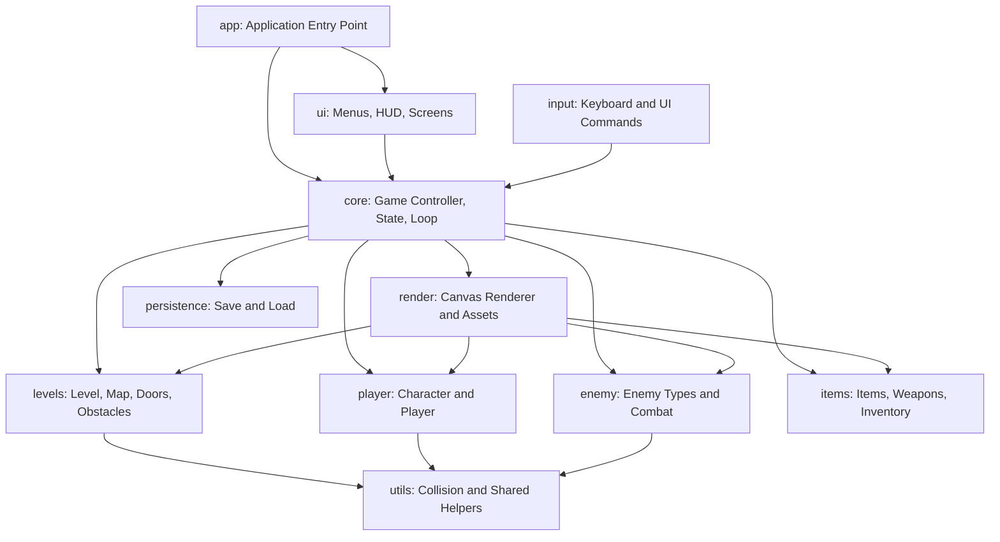
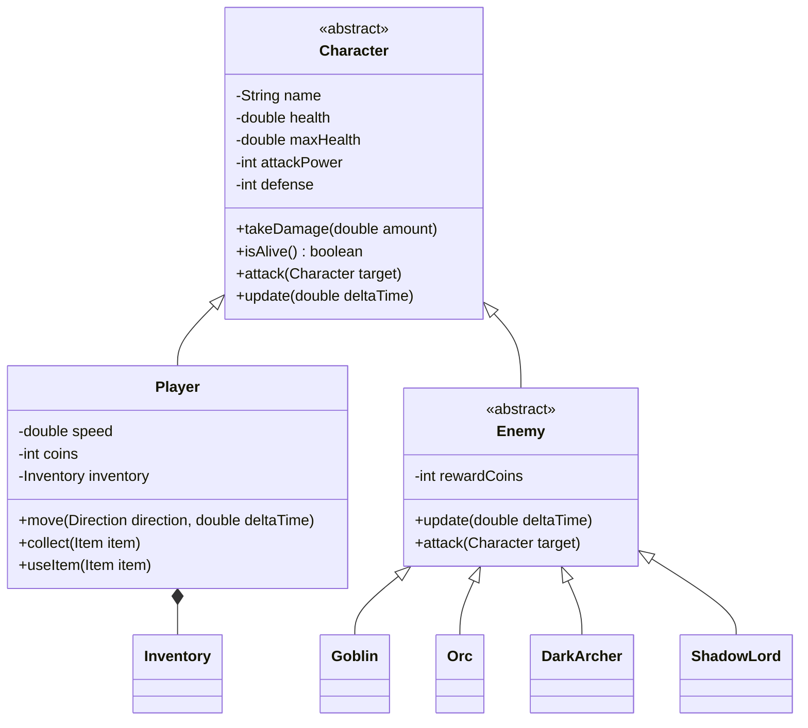
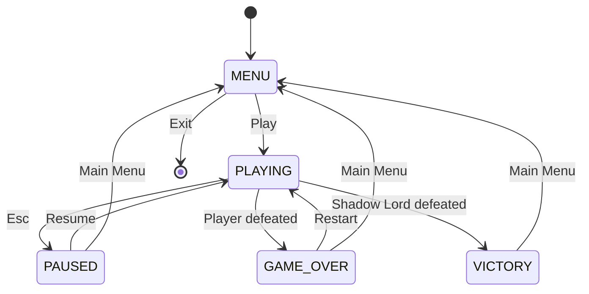

# Shadow Quest: The Lost Realm — Technical Architecture

> **Status:** Initial architecture proposal  
> **Language:** Java 21  
> **GUI/rendering:** JavaFX 21 + Canvas  
> **Build:** Maven  
> **Architecture style:** Modular, object-oriented, single-process desktop game

---

## 1. Architecture Goals

The architecture should:

- Separate game rules from JavaFX presentation.
- Allow five members to work on different modules with limited file conflicts.
- Keep player, enemy, inventory, and level logic testable without opening a game window.
- Make the game loop and input flow easy to understand.
- Demonstrate Java course concepts through meaningful functionality.
- Start small and support incremental expansion.

## 2. High-Level Module Diagram



**Dependency rule:** Domain modules (`player`, `enemy`, `items`, `levels`) must not depend on JavaFX controls, Stage, Scene, or Canvas. The UI and renderer may read domain state and draw it, but should not own gameplay rules.

## 3. Recommended Maven Directory Structure

```text
shadow-quest-lost-realm/
├── pom.xml
├── README.md
├── CONTRIBUTING.md
├── .gitignore
├── docs/
│   ├── PROJECT_PLAN.md
│   └── ARCHITECTURE.md
├── src/
│   ├── main/
│   │   ├── java/
│   │   │   └── com/shadowquest/
│   │   │       ├── app/
│   │   │       │   └── Main.java
│   │   │       ├── core/
│   │   │       │   ├── Game.java
│   │   │       │   ├── GameState.java
│   │   │       │   └── GameConfig.java
│   │   │       ├── input/
│   │   │       │   └── InputHandler.java
│   │   │       ├── player/
│   │   │       │   ├── Character.java
│   │   │       │   └── Player.java
│   │   │       ├── enemy/
│   │   │       │   ├── Enemy.java
│   │   │       │   ├── Goblin.java
│   │   │       │   ├── Orc.java
│   │   │       │   ├── DarkArcher.java
│   │   │       │   └── ShadowLord.java
│   │   │       ├── items/
│   │   │       │   ├── Item.java
│   │   │       │   ├── Weapon.java
│   │   │       │   ├── HealthPotion.java
│   │   │       │   ├── Key.java
│   │   │       │   ├── Inventory.java
│   │   │       │   ├── Attackable.java
│   │   │       │   └── Collectable.java
│   │   │       ├── levels/
│   │   │       │   ├── Level.java
│   │   │       │   ├── ForestLevel.java
│   │   │       │   ├── RuinsLevel.java
│   │   │       │   ├── DungeonLevel.java
│   │   │       │   └── CastleLevel.java
│   │   │       ├── render/
│   │   │       │   ├── GameRenderer.java
│   │   │       │   └── AssetManager.java
│   │   │       ├── ui/
│   │   │       │   ├── ScreenManager.java
│   │   │       │   ├── MainMenuScreen.java
│   │   │       │   ├── GameScreen.java
│   │   │       │   ├── PauseScreen.java
│   │   │       │   ├── GameOverScreen.java
│   │   │       │   └── VictoryScreen.java
│   │   │       ├── persistence/
│   │   │       │   ├── SaveService.java
│   │   │       │   ├── SaveData.java
│   │   │       │   └── InvalidSaveException.java
│   │   │       └── utils/
│   │   │           ├── Collision.java
│   │   │           └── Direction.java
│   │   └── resources/
│   │       ├── images/
│   │       ├── maps/
│   │       ├── audio/
│   │       └── styles/
│   └── test/
│       └── java/com/shadowquest/
│           ├── player/
│           ├── enemy/
│           ├── items/
│           ├── levels/
│           └── persistence/
└── .github/
    └── PULL_REQUEST_TEMPLATE.md
```

This is a target structure, not a requirement to create every file in the first commit. Add classes when their phase begins. Package names may be refined, but changes must be agreed by the team.

## 4. Module Responsibilities

### 4.1 `app`

- Contains the JavaFX `Application` subclass and startup entry point.
- Creates the initial Stage and delegates screen flow to `ScreenManager`.
- Must not contain combat, inventory, or level rules.

### 4.2 `core`

- Owns the active game session.
- Coordinates player, current level, game state, update steps, and transitions.
- Defines `GameState`, such as `MENU`, `PLAYING`, `PAUSED`, `GAME_OVER`, and `VICTORY`.
- Does not draw UI elements.

### 4.3 `input`

- Converts keyboard input into game actions or an input-state object.
- Tracks pressed movement keys so movement is continuous while a key is held.
- Maps Space to attack, E to interact, and Esc to pause.
- Does not directly change JavaFX screens from domain classes.

### 4.4 `player`

- Defines shared character properties in abstract `Character`.
- Implements player movement state, health, defence, attack, and equipment interaction.
- Exposes validated methods rather than allowing arbitrary direct field mutation.
- Does not import JavaFX classes.

### 4.5 `enemy`

- Defines common enemy state and behaviour in `Enemy`.
- Implements Goblin, Orc, DarkArcher, and ShadowLord.
- Supports polymorphic update/attack behaviour.
- Uses simple, bounded behaviour appropriate for the first version.

### 4.6 `items`

- Defines common `Item` data and item behaviour.
- Implements weapons, health potions, and keys.
- Owns inventory operations, capacity rules if used, and item-use validation.
- Uses collections with generics.
- Does not draw inventory UI.

### 4.7 `levels`

- Defines level dimensions/layout and collections of enemies, items, and obstacles.
- Implements the four planned locations.
- Owns doors, level exits, keys required for progression, and puzzle state.
- Does not own player health or inventory internals.

### 4.8 `render`

- Draws the current game world and visible entities onto a JavaFX Canvas.
- Loads assets from classpath resources.
- Uses placeholder shapes if an optional sprite is unavailable.
- Must not change health, defeat enemies, collect items, or advance levels as a side effect of drawing.

### 4.9 `ui`

- Owns menus, HUD, buttons, screen layout, and navigation.
- Sends commands to the game controller.
- Displays state supplied by the game/domain modules.
- Does not duplicate game rules.

### 4.10 `persistence`

- Converts the necessary game state to and from a documented save format.
- Validates loaded data before applying it.
- Handles I/O errors and malformed data with meaningful exceptions/messages.
- Does not serialize JavaFX objects, Canvas, Stage, or live event handlers.

### 4.11 `utils`

- Contains small reusable helpers such as collision calculations and shared direction types.
- Avoid turning this package into a dumping ground for unrelated logic.

## 5. Core Object Model



The diagram is conceptual. Exact fields and signatures must be agreed before implementation. Avoid adding duplicate health or attack fields to subclasses if they already exist in `Character`.

### Important design choice: `Character` and `Enemy`

Use one abstract `Character` base class for shared character properties and operations. `Player` and `Enemy` extend it. `Enemy` is also abstract and provides enemy-specific common behaviour. This avoids making `Enemy` an unrelated hierarchy.

### Interfaces

Use interfaces only where they express a useful capability:

- `Attackable`: a target that can receive an attack/damage operation.
- `Collectable`: an object that can be collected or interacted with.

Do not force every item or character to implement an interface if it does not make semantic sense.

## 6. Initial API Contracts

These signatures are proposed integration contracts. The team should approve them before parallel implementation. Codex must not silently invent incompatible alternatives.

### `Character`

```java
public abstract class Character {
    protected Character(String name, double maxHealth, int attackPower, int defense);

    public String getName();
    public double getHealth();
    public double getMaxHealth();
    public int getAttackPower();
    public int getDefense();
    public boolean isAlive();

    public void takeDamage(double amount);
    public void heal(double amount);

    public abstract void update(double deltaTime);
    public abstract void attack(Character target);
}
```

Implementation note: fields should preferably be `private`; use `protected` constructors and methods only when inheritance genuinely requires them. Reject negative damage/healing and clamp health to valid bounds.

### `Player`

```java
public class Player extends Character {
    public Player(String name);
    public double getSpeed();
    public Inventory getInventory();

    public void move(Direction direction, double deltaTime);
    public void collect(Item item);
    public boolean useItem(Item item);
}
```

Movement should be expressed in world coordinates and constrained by collision/level boundaries. The UI should not directly set arbitrary player coordinates.

### `Enemy`

```java
public abstract class Enemy extends Character {
    public int getRewardCoins();
    public abstract void update(double deltaTime, Player player);
}
```

If the team chooses a shared `update(double deltaTime)` contract instead, keep player-awareness in a separate AI method/service. Do not create inconsistent update signatures across enemy types.

### `Inventory`

```java
public class Inventory {
    public boolean addItem(Item item);
    public boolean removeItem(Item item);
    public boolean containsItem(String itemId);
    public List<Item> getItems();
}
```

Return an unmodifiable view or defensive copy from `getItems()` so callers cannot bypass inventory rules.

### `Level`

```java
public abstract class Level {
    public String getId();
    public String getDisplayName();
    public List<Enemy> getEnemies();
    public List<Item> getItems();

    public abstract void initialize();
    public abstract boolean isCompleted();
}
```

Collections exposed to other modules should not allow uncontrolled mutation. Add explicit methods for adding/removing defeated enemies or collected items.

### `Game`

```java
public class Game {
    public Game();

    public GameState getState();
    public Player getPlayer();
    public Level getCurrentLevel();

    public void startNewGame();
    public void pause();
    public void resume();
    public void update(double deltaTime);
}
```

The `Game` controller is the coordination point. Keep UI navigation in `ScreenManager`.

These are starting contracts, not permission to implement all classes at once. Refine them with the team and update this document when a deliberate API change is approved.

## 7. Game Loop and Threading

Use JavaFX `AnimationTimer` for the first version.

Conceptual flow:

```text
AnimationTimer.handle(now)
    calculate deltaTime
    if game state is PLAYING:
        read current input state
        update player
        update enemies
        process combat and collisions
        process collection/interactions
        check level completion and player death
    render current state to Canvas
```

Rules:

- Keep update logic separate from rendering.
- Use `deltaTime` for movement so speed is not tied directly to frame rate.
- Do not use `Thread.sleep()` on the JavaFX Application Thread.
- Keep JavaFX scene graph and UI changes on the JavaFX Application Thread.
- Do not introduce multithreading unless asset loading or another measured task requires it.
- Prevent repeated attacks/interactions from firing every frame unintentionally; use input edge detection or cooldowns.

## 8. Coordinate, Collision, and Map Conventions

Agree on these conventions before implementing movement/rendering:

- Use a consistent world coordinate system with `(0, 0)` at the top-left.
- Positive X points right; positive Y points down.
- Keep world positions and screen positions conceptually separate if camera scrolling is later added.
- Define tile size and viewport size in one configuration class.
- Use a simple rectangle/AABB collision system initially.
- Separate solid obstacles from collectible/interactable objects.
- Use placeholder rectangles and colours before final art assets are integrated.

Initial proposed viewport: `960 × 600`. Initial tile size: `32` pixels. These are configurable starting values, not hard-coded assumptions across the codebase.

## 9. Game State and Screen Flow



Represent finite states with an enum. Ensure pause stops gameplay updates while still allowing UI interaction.

## 10. Save/Load Design

Save only domain data required to reconstruct the game:

- Save format version.
- Player health and relevant stats.
- Current level identifier.
- Player position.
- Coins.
- Inventory item identifiers and required item data.
- Level progression and required puzzle/door state.

Do not save Java object memory, JavaFX nodes, event handlers, or image objects.

Requirements:

- Use a documented format such as JSON or a simple versioned text format.
- Write saves safely; avoid leaving a partially written save if possible.
- Validate all loaded values and identifiers.
- Handle missing files separately from corrupted files.
- Use a custom `InvalidSaveException` only if it improves clarity.
- Never silently accept impossible values such as negative health, unknown level IDs, or invalid item identifiers.

Persistence is a later milestone. Do not block the first playable prototype on it.

## 11. Exception and Validation Policy

Use exceptions for exceptional/recoverable failures:

- File read/write failure.
- Malformed or unsupported save data.
- Required asset unavailable when no fallback is possible.
- Invalid external configuration.

Use normal return values or game state for expected gameplay outcomes:

- Player takes damage.
- Enemy dies.
- Inventory is full.
- Door is locked.
- Player cannot collect an item.

Validate constructor arguments and public state-changing methods. Error messages should explain what failed and what the user can do next.

## 12. Testing Strategy

Use JUnit 5 for domain tests if included in the Maven setup.

Test at least:

- Player health cannot exceed max health or fall below zero.
- Damage and healing reject invalid values.
- Enemy defeat and reward logic occur once.
- Different enemy subclasses exhibit polymorphic behaviour.
- Inventory add/remove/contains behaviour.
- Key checks and level transition rules.
- Collision boundaries.
- Save/load round-trip.
- Missing and corrupted save files.
- Game-state transitions and pause behaviour.

Keep most tests independent of JavaFX. UI smoke tests can be manual initially.

## 13. Asset Management

- Store assets under `src/main/resources/`.
- Load resources through classpath/resource APIs, not machine-specific absolute paths.
- Provide a placeholder fallback for non-essential images.
- Keep filenames lowercase and use hyphens or underscores consistently.
- Track asset source, author, and license in `docs/ASSETS.md` or the README.
- Do not commit assets unless the team has permission to use and redistribute them.

## 14. Build and Code Conventions

- Use Maven; commit `pom.xml` and preferably Maven Wrapper.
- Target Java 21 unless the course lab machines require another agreed version.
- Use package prefix `com.shadowquest`.
- Use `PascalCase` for classes, `camelCase` for methods/variables, and `UPPER_SNAKE_CASE` for constants.
- Keep fields private by default.
- Prefer small methods with one responsibility.
- Use generics; avoid raw collections.
- Avoid static mutable global game state.
- Do not put all game logic in `Main.java`.
- Add comments to explain non-obvious decisions, not every line.
- Keep commits and pull requests focused.

## 15. Integration Contract Between Members

Before implementation begins, the team must agree on:

1. The exact Java version and Maven setup.
2. Package ownership and file ownership.
3. The initial API signatures in Section 6.
4. Coordinate units, tile size, and viewport.
5. Who owns `Game`, `GameState`, input, and renderer integration.
6. How the renderer reads entities without mutating them.
7. How level transitions are requested and reported.
8. The save format and the state included in it.

When an API change is necessary:

- Open an issue or discuss it with the affected module owners.
- Update this architecture document.
- Update callers and tests in the same pull request where practical.
- Do not merge a breaking change without notifying dependent members.

## 16. Architecture Decision Summary

| Decision | Initial choice | Reason |
|---|---|---|
| Language | Java 21 | Modern LTS baseline |
| GUI | JavaFX | Course GUI and event handling requirements |
| Rendering | Canvas | Suitable for a simple 2D game world |
| Build | Maven | Repeatable dependency/build setup |
| Game loop | AnimationTimer | JavaFX-native frame updates |
| Domain/UI separation | Separate packages | Easier testing and team collaboration |
| Collision | AABB rectangles | Simple and sufficient for prototype |
| Collections | ArrayList and Set as appropriate | Type-safe game entity storage |
| Persistence | Versioned JSON or text, later phase | Easy to validate and evolve |
| Version control | Fork + feature branch + PR | Controlled group integration |

---

**Architecture principle:** Build a small, working vertical slice first. Do not generate the entire game in one step. Every module should integrate through agreed contracts and remain independently testable.
