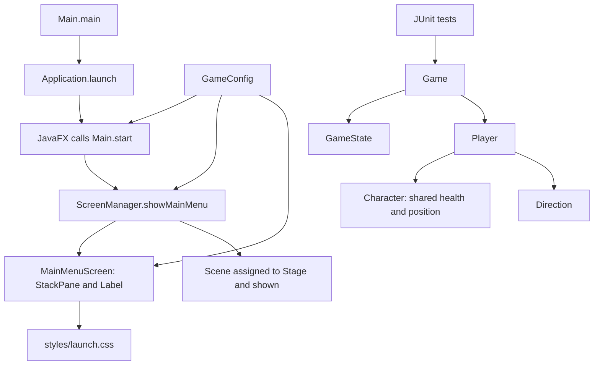
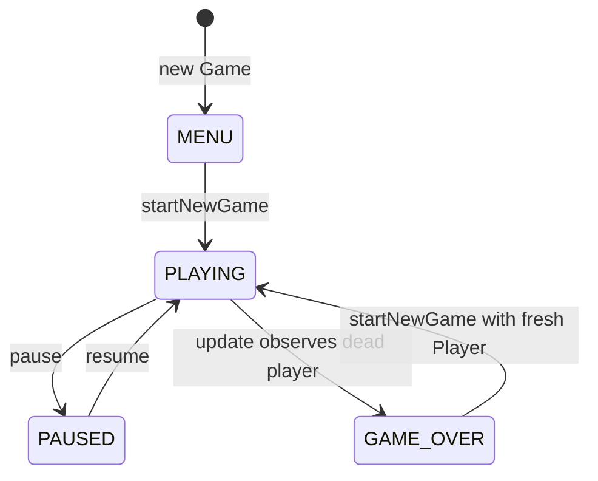

# Shadow Quest: The Lost Realm
# Java project technical documentation and learning report

Verified against the source code and tests on November 13, 2026. This guide
explains each file, its actual Java concepts, and its connections to other files.
The development history follows the learning sections. Plans describe intended
features; only source code and observed verification establish implemented work.

## Learning guide contents

1. [Scope and vocabulary](#scope-and-vocabulary)
2. [Folders and supporting files](#folders-and-supporting-files)
3. [Production Java files](#production-java-files)
4. [Class connections and execution](#class-connections-and-execution)
5. [Test files and JUnit 5](#test-files-and-junit-5)
6. [Consolidated Java concepts](#consolidated-java-concepts)
7. [Viva preparation](#viva-preparation)
8. [Current verification](#current-verification)
9. [Development history](#development-history)

## Scope and vocabulary

There are nine production Java files: seven classes and two enums. There are
three test Java files, with one additional nested test-only class inside
CharacterTest. The implemented scope is the title-screen foundation plus game
states, character health/statistics, coordinates, and player movement calculations.
The title screen does not yet create a Game or accept keyboard movement.

The code defines JavaFX startup, but local visual verification is blocked by
Windows Application Control. This is not yet a verified playable game. The core
foundation is only a subset of the broader Phase 1 described in PROJECT_PLAN.md.

| Term | Meaning and example |
| --- | --- |
| Class | Definition of an object's data and operations, such as Player |
| Object | Instance created from a class, such as new Player("Arin") |
| Field | Variable belonging to an object or class, such as health |
| Local variable | Variable inside a method or constructor, such as distance in move |
| Method | Named operation, such as heal(double amount) |
| Constructor | Initialization code used when creating an object; it has no return type |
| Reference | Value identifying an object; Game.player refers to a Player |
| null | Absence of an object reference; player is null before a game starts |
| Domain logic | Rules/data that do not require a window, such as health calculations |
| API contract | The permitted inputs, outputs, and behavior of an operation |
| void | A method returns no value, although it may change state |
| Finite double | A floating-point number that is neither infinity nor NaN, meaning not-a-number |

## Folders and supporting files

Paths in inventory tables are relative to `C:\java game`. Java subsections also
provide complete local paths. Packages separate Java names and responsibilities;
they are not independent applications or Maven modules.

### Package inventory

All production packages are under `src/main/java/com/shadowquest/`.

| Folder | Actual contents | Responsibility/status |
| --- | --- | --- |
| app | Main.java | Implemented JavaFX entry point |
| core | Game.java, GameConfig.java, GameState.java | Implemented session coordination, constants, and state vocabulary |
| ui | ScreenManager.java, MainMenuScreen.java | Implemented title screen; multiple-screen navigation is pending |
| player | Character.java, Player.java, .gitkeep | Implemented health and movement foundation; no combat/inventory |
| utils | Direction.java, .gitkeep | Shared movement enum; no collision helper yet |
| enemy | .gitkeep only | Reserved for enemies |
| items | .gitkeep only | Reserved for items, inventory, and collection |
| levels | .gitkeep only | Reserved for level models and progression |
| input | .gitkeep only | Reserved for keyboard-to-action conversion |
| render | .gitkeep only | Reserved for Canvas world rendering and assets |
| persistence | .gitkeep only | Reserved for saving and loading domain data |

`src/main/resources/` contains `styles/launch.css`. Its `images/`, `maps/`,
and `audio/` folders contain only `.gitkeep` markers. No game art/audio is present.

Under `src/test/java/com/shadowquest/`, `core/` contains GameTest.java and
`player/` contains CharacterTest.java, PlayerTest.java, and .gitkeep. The test
folders enemy, items, levels, and persistence contain only .gitkeep markers.

Git does not preserve empty directories. A `.gitkeep` is an empty conventionally
named file that lets a folder be committed. It is not a Java class or stub.
All 16 markers remain, including harmless markers in now-populated packages.

### Build configuration: pom.xml

POM means Project Object Model. Maven reads this XML file to identify the project,
obtain libraries, compile Java, and run tests. A dependency is a library; a plugin
performs a build task.

| Setting | Actual value and meaning |
| --- | --- |
| groupId | com.shadowquest, the project's group namespace |
| artifactId | shadow-quest-lost-realm, the build artifact name |
| version | 0.1.0-SNAPSHOT, a development version |
| maven.compiler.release | 21, the Java language/API target used by compilation |
| Source/report encodings | UTF-8, an explicit text encoding |
| javafx.version | 21.0.13, the pinned JavaFX library version |
| junit.version | 5.13.4, the pinned test library version |

`javafx-controls` provides controls such as Label and transitively brings in
JavaFX graphics/base. Canvas is available from graphics, but the project does
not create one yet. `junit-jupiter` has test scope, so JUnit is used to compile
and run tests rather than as an application dependency.

The compiler plugin 3.14.0 compiles Java; Surefire 3.5.3 runs tests; the JavaFX
plugin 0.0.8 launches `com.shadowquest.app.Main` for `javafx:run`. `clean`
removes target output. `compile` compiles production code. `test` includes
compilation and then runs tests. There is no module-info.java, multi-module Maven
build, FXML dependency, Swing usage, database, or third-party game engine.

### Every supporting file and its purpose

| Repository-relative file | Explanation |
| --- | --- |
| src/main/resources/styles/launch.css | `.launch-screen` uses background #171b2e. `.game-title` uses System font, size 36px, bold weight, #f3e6bf text, and centered text alignment. MainMenuScreen attaches these classes; CSS changes appearance, not game rules. |
| mvnw | Official Unix Maven Wrapper launcher 3.3.4. Reads wrapper properties, downloads Maven if absent, then forwards the requested command. README uses `sh ./mvnw`. |
| mvnw.cmd | Official Windows wrapper launcher using batch/PowerShell logic. Forwards commands to Maven. Credential-variable names in the script do not contain stored credentials. |
| .mvn/wrapper/maven-wrapper.properties | Pins wrapper 3.3.4, only-script distribution, and Maven 3.9.11 via HTTPS Maven Central. There is no pinned distribution checksum in this file. |
| .gitignore | Excludes target, .tools, caches, IDE files, packaged binaries, logs, temporary files, and local secret/key files. Includes a wrapper-JAR exception, though this wrapper uses no JAR. Ignore rules do not replace staged-file review. |
| .gitattributes | Uses automatic text handling, explicit LF for mvnw and CRLF for mvnw.cmd, preventing inappropriate wrapper line endings on different operating systems. |
| .github/PULL_REQUEST_TEMPLATE.md | Review prompts for behavior, tests, contracts, and asset attribution. It is not an automated CI workflow. |
| README.md | Prerequisites, build/run commands, structure, current scope, and troubleshooting. |
| CONTRIBUTING.md | Five-member responsibilities, fork/branch/PR process, tests, and report-maintenance rules. |
| docs/PROJECT_PLAN.md | Original game objectives, phases, story, team roles, and completion criteria. A planned feature is not automatically implemented. |
| docs/ARCHITECTURE.md | Original package boundaries, proposed APIs, rendering/threading conventions, and future designs. |
| docs/INITIALIZATION.md | Historical Phase 0 inventory and environment evidence. Its zero-test statement describes Phase 0 at that time. |
| docs/IMPLEMENTATION_LOG.md | Phase 1 contracts, decisions, tests, limitations, and continuation checks. |
| docs/PROJECT_DEVELOPMENT_REPORT.md | This learning guide and permanent development record. |

Generated `target/` contains class files and Surefire reports. Ignored `.tools/`
contains the portable JDK, Maven, dependency caches, and audit artifacts. Neither
belongs in the source commit. `.git/` is local Git metadata, not an application
resource or a normal committed project file.

## Production Java files

### Main.java

#### A. File information

Exact path: `C:\java game\src\main\java\com\shadowquest\app\Main.java`.
Declaration: `public final class Main extends Application` in the app package.
It provides the JavaFX entry point and delegates layout work to the UI package.

#### B. Code explanation

There are no fields or explicit constructors. Java supplies a public no-argument
constructor, allowing the JavaFX launcher to create the application object.

| Method | Parameters and return type | Working |
| --- | --- | --- |
| main | String[] args; public static void | Forwards command-line arguments to inherited launch(args). It does not call start directly. |
| start | Stage stage; public void | Receives JavaFX's primary window, sets its title from GameConfig.TITLE, constructs ScreenManager with that Stage, and calls showMainMenu. |

Stage means the top-level window. stage is a parameter, not a field.
`new ScreenManager(stage).showMainMenu()` creates an object and immediately calls
one of its methods. JavaFX invokes start on its Application Thread, which is used
for UI operations. No Game object or game loop is created here.

#### C. Java concepts used

| Concept | Meaning, actual example, and reason |
| --- | --- |
| Class/object | Main defines startup behavior; JavaFX constructs it. `new ScreenManager(stage)` creates a separate presentation object. |
| Inheritance | `extends Application` makes Main a JavaFX application and gives access to launch. |
| Method overriding | `@Override public void start(Stage stage)` implements the framework's startup operation. The annotation lets the compiler check the override. |
| Framework polymorphism | JavaFX invokes Main's overridden start method through its application lifecycle. This is actual runtime method selection; enemy polymorphism remains planned. |
| Static | main belongs to the class and can be called without first constructing Main in user code. |
| Final | `final class Main` cannot be subclassed; it does not make all referenced objects immutable. |
| Packages/imports | app groups startup code; imports identify GameConfig, ScreenManager, Application, and Stage. |
| JavaFX | Application and Stage define the GUI lifecycle. No custom button or keyboard event handling exists here. |

### GameConfig.java

#### A. File information

Exact path: `C:\java game\src\main\java\com\shadowquest\core\GameConfig.java`.
Declaration: `public final class GameConfig`. Shared window settings avoid
repeating the title and scene dimensions across UI files.

#### B. Code explanation

| Field | Type/modifiers | Value and use |
| --- | --- | --- |
| TITLE | public static final String | "Shadow Quest: The Lost Realm", used for the Stage title and Label text |
| VIEWPORT_WIDTH | public static final int | 960, passed to the Scene constructor |
| VIEWPORT_HEIGHT | public static final int | 600, passed to the Scene constructor |

`private GameConfig()` prevents other classes from constructing instances.
Its empty body is intentional for a constants-only class. There are no ordinary
methods. The dimensions describe the initial scene area, not native window
borders, and the code does not disable resizing.

#### C. Java concepts used

| Concept | Meaning, actual example, and reason |
| --- | --- |
| Static | `GameConfig.TITLE` is available without creating an object. |
| Final fields | The title and dimensions cannot be reassigned after initialization; there is no mutable global session state here. |
| Access control | Public exposes constants; the private constructor prevents unnecessary instances. |
| Constructor | The private constructor controls how the class may be used, despite having no statements. |
| Final class | Prevents extending a class designed only to group constants. |
| Types/package | String holds text, int holds whole-number dimensions; the class is in core and needs no explicit imports. |

There is no configuration-file loader or tile-size field in this implementation.

### GameState.java

#### A. File information

Exact path: `C:\java game\src\main\java\com\shadowquest\core\GameState.java`.
Declaration: `public enum GameState`. It defines session-state names without
allowing arbitrary string values.

#### B. Code explanation

| Constant | Current meaning |
| --- | --- |
| MENU | Initial state; no Player yet |
| PLAYING | Active session; update may detect death |
| PAUSED | Session preserved, with no Game.update processing |
| GAME_OVER | Player defeat detected; restarting is permitted |
| VICTORY | Declared for later progression work; currently unreachable through Game's API |

The enum declares no custom fields, constructors, or methods. Game compares its
values using `==`. It defines state vocabulary, not transition rules or screens.

#### C. Java concepts used

An enum is a type with a fixed set of named values. In Game,
`private GameState state = GameState.MENU;` cannot be assigned `"Playng"`.
This gives compiler-checked state names. Public allows other packages to use
the enum; the core package places it beside its main consumer, Game.

### Game.java

#### A. File information

Exact path: `C:\java game\src\main\java\com\shadowquest\core\Game.java`.
Declaration: `public class Game`. It coordinates one session independently of
JavaFX, making the rules testable without opening a window.

#### B. Code explanation

| Field | Type | Purpose |
| --- | --- | --- |
| state | private GameState | Initialized to MENU; records the current session state |
| player | private Player | Current player reference; initially null through Java's default field initialization |

There is no explicit constructor. Java supplies `public Game()`; every new
instance has its own fields. No static shared player or session state exists.

| Method | Parameters / return | Working |
| --- | --- | --- |
| getState | none / GameState | Returns the current state |
| getPlayer | none / Player | Returns the actual player reference, or null before start; not a copy |
| startNewGame | none / void | From MENU or GAME_OVER, creates new Player("Arin") and then sets PLAYING; otherwise leaves state/player unchanged |
| pause | none / void | Changes PLAYING to PAUSED; other states are unchanged |
| resume | none / void | Changes PAUSED to PLAYING; other states are unchanged |
| update | double deltaTime / void | Validates finite, non-negative elapsed seconds, then detects death only while PLAYING |

The important condition is:

```java
if (state == GameState.PLAYING && !player.isAlive()) {
    state = GameState.GAME_OVER;
}
```

`&&` short-circuits: Java evaluates the second expression only if the first is
true. In MENU, it does not call isAlive on the null player. startNewGame creates
the player before entering PLAYING, and there is no public setState that bypasses
this sequence.

Zero elapsed time is valid. Invalid time throws before any state change, even
when paused. update currently validates deltaTime without using it to simulate
movement. It is a callable step, not an AnimationTimer or complete game loop.

Damage does not notify Game immediately. A playing update detects death later.
Pause/resume keep the same Player; restart creates a different Player. Calling
start while already playing or paused cannot erase the current session.

#### C. Java concepts used

| Concept | Meaning, actual example, and reason |
| --- | --- |
| Encapsulation | Private state/player prevent direct assignment; public operations enforce transitions. The returned Player remains mutable through its own methods. |
| Class/object and has-a relationship | `player = new Player("Arin")` creates the session's player; Game coordinates Player rather than extending it. |
| Default constructor | `new Game()` works without an explicitly written constructor. Field initialization creates the starting state. |
| Enum | `state == GameState.PAUSED` compares a defined state value. |
| Conditional logic | if, logical OR, logical AND, and negation implement guards; short-circuit evaluation avoids a null-player call. |
| Exception validation | IllegalArgumentException rejects invalid deltaTime. No try/catch recovery or exception for ordinary death is used. |
| Packages/imports | Game imports Player. GameState is in the same package and needs no import. There are no JavaFX imports. |

No getCurrentLevel, victory trigger, return-to-menu operation, or input handler
is implemented. These remain later integration work.

### Character.java

#### A. File information

Exact path: `C:\java game\src\main\java\com\shadowquest\player\Character.java`.
Declaration: `public abstract class Character`. This is the project's shared
character model, not `java.lang.Character`, the standard wrapper for a char.
It avoids duplicating health and position logic in Player and future character types.

#### B. Code explanation

| Field | Type/modifiers | Why it exists |
| --- | --- | --- |
| name | private final String | Nonblank character name with surrounding whitespace stripped |
| maxHealth | private final double | Positive upper health bound; double permits fractional health |
| attackPower | private final int | Non-negative whole-number statistic; no combat calculation yet |
| defense | private final int | Non-negative statistic; does not reduce incoming damage yet |
| health | private double | Current health, initially equal to maxHealth |
| x | private double | Horizontal world coordinate, initially 0.0 |
| y | private double | Vertical world coordinate, initially 0.0 |

The protected constructor takes `String name`, `double maxHealth`,
`int attackPower`, and `int defense`. It rejects null/blank names, non-positive
or non-finite maximum health, and negative attack/defense. The null-or-blank
condition short-circuits before calling a method on null.

`this.name = name.strip()` stores a trimmed name. `this` distinguishes a field
from its same-named parameter. health starts at maxHealth; x and y use Java's
default zero initialization. A constructor has no return type.

Every getter takes no parameters:

| Method | Return type | Returned value |
| --- | --- | --- |
| getName | String | name |
| getHealth | double | health |
| getMaxHealth | double | maxHealth |
| getAttackPower | int | attackPower |
| getDefense | int | defense |
| getX | double | x |
| getY | double | y |

| Other method | Parameters / return | Working |
| --- | --- | --- |
| isAlive | none / boolean | Returns health > 0; there is no separate alive flag that could disagree with health |
| takeDamage | double amount / void | Validates input, then assigns Math.max(0, health - amount) |
| heal | double amount / void | Validates input, then adds Math.min(amount, maxHealth - health) |
| moveBy | double deltaX, double deltaY / protected final void | Computes nextX/nextY, rejects non-finite results, then assigns both coordinates |
| validateHealthAmount | double amount / private static void | Shared validation for damage/healing: rejects negative numbers, NaN, and infinities |

Damage of 30 from health 100 leaves 70. Healing by 50 then adds only 30,
restoring 100. Damage beyond remaining health stops at zero. Zero damage/healing
is valid. Invalid values are rejected before mutation.

heal limits the addition before adding. Adding two enormous doubles first could
overflow to infinity; limiting to `maxHealth - health` avoids that intermediate
overflow. A dedicated test uses Double.MAX_VALUE to check it.

moveBy validates both new coordinates before assigning either. If Y is invalid,
X must also remain unchanged. This is an all-or-nothing validation sequence,
not a claim of thread safety; there is no synchronization in these classes.

Healing from zero is allowed. isAlive then becomes true, but Game.state does
not change automatically. This is a health primitive, not a resurrection item.

#### C. Java concepts used

| Concept | Meaning, actual example, and reason |
| --- | --- |
| Abstraction | `abstract class Character` cannot be directly instantiated. It provides a common model with working methods; abstract classes do not need abstract methods. |
| Encapsulation | health/x/y are private. Getters expose values while takeDamage, heal, and moveBy enforce rules. |
| Inheritance support | The protected constructor and moveBy support subclasses. Player reuses the logic but cannot directly access private fields. |
| Access modifiers | Public exposes operations, private hides fields/helpers, protected supports subclasses and same-package access. CharacterTest can call moveBy because it is in the same package. |
| Final | Final identity/stat fields cannot be reassigned. Final moveBy cannot be overridden to remove validation. health/x/y remain mutable. |
| Static helper | validateHealthAmount depends only on amount, so it needs no object state and is static. |
| Constructors and this | `this.maxHealth = maxHealth` initializes a field from the validated parameter. |
| Exceptions/numeric logic | IllegalArgumentException reports invalid input; Math.min/Math.max and Double.isFinite protect bounds. Ordinary damage and death do not throw. |
| Package | Character belongs to player. String, Math, and Double come from automatically available java.lang. |

The proposed attack and per-character update methods are absent, not empty stubs.

### Player.java

#### A. File information

Exact path: `C:\java game\src\main\java\com\shadowquest\player\Player.java`.
Declaration: `public class Player extends Character`. It adds player defaults
and movement while reusing shared character behavior.

#### B. Code explanation

| Field | Type/modifiers | Purpose |
| --- | --- | --- |
| INITIAL_MAX_HEALTH | private static final double, 100 | Starting maximum health |
| INITIAL_ATTACK_POWER | private static final int, 10 | Starting attack statistic |
| INITIAL_DEFENSE | private static final int, 5 | Starting defense statistic |
| MOVEMENT_SPEED | private static final double, 200 | Initial world units per second |
| speed | private final double | The player's fixed movement rate, assigned from MOVEMENT_SPEED |

These are starter tuning values, not a completed combat-balance design.
`public Player(String name)` calls
`super(name, INITIAL_MAX_HEALTH, INITIAL_ATTACK_POWER, INITIAL_DEFENSE)` and
then assigns speed. The parent constructor validates shared data. Player does
not declare a second copy of health or position.

| Method | Parameters / return | Working |
| --- | --- | --- |
| getSpeed | none / double | Returns speed |
| move | Direction direction, double deltaTime / void | Validates inputs, calculates distance, skips dead-player movement, and calls inherited moveBy for the selected direction |

move performs these steps in order:

1. Reject null direction.
2. Reject negative/non-finite elapsed seconds.
3. Compute local `double distance = speed * deltaTime`.
4. Reject a non-finite distance, including multiplication overflow.
5. Return if the player is dead.
6. Use the direction switch to apply displacement through moveBy.

| Direction | Actual call | Effect |
| --- | --- | --- |
| UP | moveBy(0, -distance) | Decreases Y |
| DOWN | moveBy(0, distance) | Increases Y |
| LEFT | moveBy(-distance, 0) | Decreases X |
| RIGHT | moveBy(distance, 0) | Increases X |

At speed 200, RIGHT for 0.25 seconds changes X by 50. Ten steps of 0.1 seconds
travel the same distance as one step of 1 second, within floating-point precision.
This prevents speed from depending on how often move is called.

Zero time gives no displacement. A valid distance can still overflow when added
to a huge coordinate, which moveBy catches. Negative coordinates are allowed
until boundaries/collisions exist. Dead players still reject invalid arguments.

#### C. Java concepts used

| Concept | Meaning, actual example, and reason |
| --- | --- |
| Inheritance | `extends Character` reuses health and position methods; `player.takeDamage(30)` calls the inherited implementation. |
| Constructor chaining | super initializes the parent part before speed is assigned. |
| Encapsulation | Private final speed is exposed through getSpeed; positions change through move instead of public coordinate setters. |
| Static/final | Named constants define defaults once; speed cannot be reassigned after construction. |
| Enum/switch | Direction restricts choices; arrow switch cases choose displacement without fall-through. |
| Exception validation | IllegalArgumentException rejects invalid direction/time and distance overflow. |
| Packages/imports | Imports Direction from utils. Character is in the same package. There is no Game or JavaFX import. |

Player currently overrides no methods and declares no overloads. Inheriting heal
is different from overriding it. Weapons, inventory, animations, and input handling
are not present.

### Direction.java

#### A. File information

Exact path: `C:\java game\src\main\java\com\shadowquest\utils\Direction.java`.
Declaration: `public enum Direction`. It gives movement a shared type without
coupling Player to JavaFX key codes.

#### B. Code explanation

The constants are UP, DOWN, LEFT, and RIGHT. There are no custom fields,
constructors, or methods. Direction does not store vectors; Player's switch
implements the coordinate changes.

Example: `player.move(Direction.RIGHT, 0.25)`. The String `"RIGHT"` cannot be
passed directly. Null is still possible for a reference, so Player checks it.

#### C. Java concepts used

An enum defines a fixed set of named values, letting the compiler check the
argument type. Public exposes it across packages; utils places it in shared code.
Direction.RIGHT is the concrete example used in movement tests. It is not a
keyboard binding or event handler.

### ScreenManager.java

#### A. File information

Exact path: `C:\java game\src\main\java\com\shadowquest\ui\ScreenManager.java`.
Declaration: `public final class ScreenManager`. It separates scene presentation
from Main. Only the title screen is currently managed; full navigation is pending.

#### B. Code explanation

`private final Stage stage` stores the window passed by Main.
`public ScreenManager(Stage stage)` assigns `this.stage = stage`. It does not
create a second Stage or validate null; the startup caller supplies JavaFX's Stage.

`public void showMainMenu()` takes no parameters. It constructs MainMenuScreen,
creates local `Scene scene` with that root and GameConfig's dimensions, sets it
on the Stage, and calls stage.show(). A Scene contains the UI tree inside a
Stage; it is not a game level or GameState.

Repeated calls would create another title-screen Scene. There is no scene cache,
screen collection, or call to Game.startNewGame.

#### C. Java concepts used

| Concept | Meaning, actual example, and reason |
| --- | --- |
| Objects/references | The constructor receives an existing Stage and showMainMenu creates a Scene and MainMenuScreen. Objects collaborate through references. |
| Encapsulation | Private stage is used through the public presentation operation. |
| Constructor/this | `this.stage = stage` stores the argument for later use. |
| Final | Final class prevents subclasses; final stage prevents replacing the reference, not changing the referenced window. |
| JavaFX | Stage owns the window; Scene owns its content. Main calls the method during JavaFX startup. |
| Packages/imports | Imports GameConfig, Scene, Stage; MainMenuScreen needs no import because it is also in ui. |

### MainMenuScreen.java

#### A. File information

Exact path: `C:\java game\src\main\java\com\shadowquest\ui\MainMenuScreen.java`.
Declaration: `public final class MainMenuScreen extends StackPane`. It owns title
layout and styling. Despite its name, it contains one Label and no menu buttons.

#### B. Code explanation

There are no declared fields or ordinary methods. Its public no-argument
constructor builds the screen. `Label title` is a local variable created with
GameConfig.TITLE, not a stored field.

| Constructor operation | Purpose |
| --- | --- |
| title.getStyleClass().add("game-title") | Associates the Label with its CSS rule |
| title.setWrapText(true) | Allows wrapping when width is limited |
| title.setAlignment(Pos.CENTER) | Centers the Label's content |
| title.setMaxWidth(Double.MAX_VALUE) | Permits expansion across available layout width; does not set the window to that enormous size |
| setPadding(new Insets(32)) | Adds space inside the pane edges |
| getStyleClass().add("launch-screen") | Associates the pane with its background CSS rule |
| getChildren().add(title) | Adds the Label to the pane; StackPane centers children by default |
| getStylesheets().add(...) | Attaches the CSS URL to this screen |

The resource expression is
`MainMenuScreen.class.getResource("/styles/launch.css").toExternalForm()`.
The leading slash searches from the classpath root. Maven copies resources to
the build output, so no personal absolute path is needed. toExternalForm converts
the URL to the String expected by the stylesheet list.

There is no missing-resource fallback. If the stylesheet is absent, getResource
returns null and the following method call fails. The resource is currently present.

#### C. Java concepts used

| Concept | Meaning, actual example, and reason |
| --- | --- |
| Inheritance | Extends StackPane and uses inherited setPadding, getChildren, and getStylesheets methods. No methods are overridden. |
| Constructor/objects | Constructor creates a Label and Insets, then configures the inherited layout object. |
| Framework collections | getChildren returns a node list; getStyleClass/getStylesheets return string lists. `.add(title)` and `.add("game-title")` are actual collection operations, not an implemented inventory collection. |
| Enum use | Pos.CENTER is a JavaFX enum constant for alignment, separate from the project's Direction. |
| Class literal/resource lookup | MainMenuScreen.class supplies the Class used to locate CSS on the classpath. This is resource loading, not save-file persistence. |
| Final/packages/imports | Final prevents subclassing; imports name GameConfig, Insets, Pos, Label, and StackPane. |
| JavaFX/CSS | Nodes define UI structure, while CSS controls appearance separately from domain logic. |

No custom event handler, Canvas, or AnimationTimer is created in this file.

## Class connections and execution

### Two separate paths currently exist



The diagram deliberately has no arrow from the title screen to Game. There is
no such call in the current code. Likewise, Direction does not receive keyboard
events. Future input integration must connect these paths explicitly.

ScreenManager calls the MainMenuScreen constructor and attaches its resulting
node to a Scene. MainMenuScreen reads the title constant and CSS. These UI classes
do not calculate health or movement. Game creates a Player; Player delegates
shared initialization and position changes to Character.

### Current transition rules



VICTORY exists in the enum but has no implemented incoming transition. There is
no return-to-menu operation. The fuller screen-flow diagram in ARCHITECTURE.md
describes future behavior, not this completed set of operations.

### Worked domain example

This example combines existing method calls. It is not an extra source file or
the current application's automatic startup flow.

```java
Game game = new Game();
game.startNewGame();
Player arin = game.getPlayer();
arin.move(Direction.RIGHT, 0.25);
arin.takeDamage(30);
arin.heal(10);
game.pause();
game.update(0.016);
game.resume();
arin.takeDamage(1000);
game.update(0.016);
game.startNewGame();
```

Step by step:

1. new Game starts in MENU with no Player.
2. startNewGame creates Arin at health 100 and coordinates `(0, 0)`.
3. Moving RIGHT for 0.25 seconds adds `200 * 0.25 = 50` to X.
4. Damage 30 leaves health 70; healing 10 raises it to 80.
5. pause changes the state to PAUSED. The next update validates time but does
   not process defeat or other game rules.
6. resume changes back to PLAYING. Damage 1000 clamps health to zero.
7. The next update sees isAlive is false and enters GAME_OVER.
8. startNewGame constructs a fresh Player with full health at the origin.

The local variable arin still refers to the previous Player after restart.
Use game.getPlayer again to obtain the new one. A returned object reference is
not automatically redirected when the field that originally supplied it changes.

Player does not know Game.state. Direct calls such as arin.move while paused
can still move a living player. The future input/controller code must restrict
movement calls to PLAYING. This separation keeps Player independent of sessions
and JavaFX; it is also an integration responsibility, not a completed input feature.

## Test files and JUnit 5

Tests create domain objects and compare results with expectations. They are not
game screens. Maven Surefire discovers the three test classes and runs JUnit.
No test starts JavaFX, sleeps for animation, or requires a rendered window.

### Common JUnit concepts actually used

| Construct | Meaning | Actual example and purpose |
| --- | --- | --- |
| @Test | Marks an ordinary test method | GameTest.startsNewGameWithArin checks starting a session |
| @ParameterizedTest | Runs one method repeatedly with supplied arguments | PlayerTest.movesInEachWorldDirection checks four directions |
| @ValueSource | Supplies one argument per execution | Invalid-time tests receive -1, NaN, and infinities |
| @NullAndEmptySource | Supplies null and an empty value | Name tests check both absent and empty names |
| @CsvSource | Supplies comma-separated argument rows | `"UP, 0, -50"` supplies Direction and expected coordinates |
| assertEquals | Checks expected and actual values | Health after damage must equal 69.5 in CharacterTest |
| assertTrue/assertFalse | Check boolean conditions | isAlive must be false after lethal damage |
| assertNull/assertNotNull | Check reference presence | Game has no player before start and has one afterwards |
| assertSame/assertNotSame | Check whether references identify the same object | Pause preserves the player; restart replaces it |
| assertThrows | Requires an operation to throw a particular exception | Invalid movement time must throw IllegalArgumentException |
| Numeric tolerance | Allows a small floating-point difference | Movement assertions use a delta of 0.000001 |
| Static imports | Allow calling static assertion methods without the Assertions prefix | `import static org.junit.jupiter.api.Assertions.*;` |
| Lambda expression | Supplies an operation to run later | `() -> player.move(null, 1)` is passed to assertThrows |

JUnit converts the CSV direction names into Direction values for the typed
parameter. It is test input conversion, not production string-based movement.
The lambda passed to assertThrows targets JUnit's Executable functional interface;
the project declares no custom gameplay interface. JUnit, not a project try/catch
block, catches and checks the expected exception.

Tests follow an arrange/act/assert pattern: create a known object, call an
operation, then check results. All test methods here return void. Classes and
methods are package-private, which JUnit 5 supports. The test classes declare no
fields or explicit outer-class constructors; they construct fresh objects in the
methods. There are no @BeforeEach hooks, disabled tests, mocks, or custom runners.

### GameTest.java

#### A. File information

Exact path: `C:\java game\src\test\java\com\shadowquest\core\GameTest.java`.
Class: `GameTest`, testing Game and its interactions with Player and GameState.
It protects session transitions and prevents accidental loss or sharing of state.

#### B. Code explanation and coverage

Important local variables are `Game game`, `Player player`, and
`Player previousPlayer`. They let tests observe both values and object identity.
The independent-session test uses `Game first` and `Game second`. The parameter
`double time` supplies invalid elapsed-time values.

All methods below return void. Only invalidTimeNeverChangesState has a parameter;
the others take none.

| Test method | Executions | Behavior and why it matters |
| --- | ---: | --- |
| beginsInMenuWithoutAPlayer | 1 | pause/resume/update do not start an unstarted game or dereference a null player |
| startsNewGameWithArin | 1 | Starting creates a living Arin and enters PLAYING |
| pauseAndResumePreserveTheSessionAndIgnoreRepeatedCommands | 1 | Repeated commands preserve state, health, position, and the same Player reference |
| startCannotReplaceAnActiveOrPausedSession | 1 | Repeated start cannot silently discard progress |
| updateLeavesLivingPlayerAndStateUnchanged | 1 | A living player remains in PLAYING; update does not invent movement or healing |
| deathBecomesGameOverOnUpdate | 1 | Death is observed on update; pause/resume cannot escape GAME_OVER |
| pausedUpdateDefersDeathDetectionUntilPlayingAgain | 1 | Even externally changed health is not processed by a paused update; resumed update detects it |
| healingCannotResumeAGameOverSession | 1 | Raising health on the old player cannot automatically resume the session |
| restartingAfterDefeatCreatesAFreshPlayer | 1 | Restart resets health/position and replaces the player; modifying the old player does not change the new one |
| invalidTimeNeverChangesState(double time) | 4 | -1, NaN, positive infinity, negative infinity throw without changing MENU, PLAYING, or PAUSED |
| separateGamesDoNotSharePlayerOrState | 1 | Defeat in one Game does not affect a separate Game |

There are 11 test methods and 14 executions. Testing both returned values and
reference identity matters: a replacement Player with similar values would still
break the promise that pausing preserves the same session object.

#### C. Java concepts used

- **Objects and references:** `Player previousPlayer = game.getPlayer()` holds
  the old object so assertNotSame can verify replacement on restart.
- **Enums:** assertions compare GameState values, not arbitrary strings.
- **Packages/imports:** core groups the tests with Game; imports bring in Player,
  Direction, and JUnit annotations. Static imports shorten assertion calls.
- **Annotations/parameterized tests:** @ValueSource repeats one invalid-input
  check for four doubles, avoiding four duplicated test bodies.
- **Lambdas and exception verification:** `() -> game.update(time)` delays the
  call until assertThrows executes it. A missing exception causes test failure.
- **Encapsulation through public APIs:** tests use Game methods rather than
  directly setting its private state, so they check the behavior callers receive.

### CharacterTest.java

#### A. File information

Exact path: `C:\java game\src\test\java\com\shadowquest\player\CharacterTest.java`.
Class: `CharacterTest`, testing shared Character rules independently of Player's
fixed defaults. It includes `private static class TestCharacter extends Character`.

#### B. Code explanation and coverage

The nested TestCharacter declares no fields or ordinary methods. Its constructor
takes `String name`, `double maxHealth`, `int attackPower`, and `int defense`,
then calls super with those arguments. It makes the abstract base usable for
tests of custom maximum health and statistics without adding a production type.

Most methods use local `Character character = new TestCharacter(...)`. This is
a superclass reference to a subclass object. It demonstrates substitutability,
but does not demonstrate overridden enemy behavior because TestCharacter adds
no overrides. Same-package access permits calling protected moveBy directly.

All test methods return void. Parameters appear only where listed:

| Test method | Executions | Behavior and edge cases |
| --- | ---: | --- |
| initializesSharedPropertiesAndTrimsName | 1 | Custom stats, full health, origin, and stripped name are initialized correctly |
| rejectsMissingNames(String name) | 4 | Rejects null, empty string, space, and tab/newline-only name |
| rejectsInvalidMaximumHealth(double maxHealth) | 5 | Rejects zero, negative health, NaN, and both infinities |
| rejectsNegativeStats(int attack, int defense) | 2 | Rejects negative attack and negative defense separately |
| acceptsZeroAttackAndDefense | 1 | Zero is valid, preventing over-restrictive validation |
| damageAndHealingChangeHealthWithoutApplyingCombatStats | 1 | Fractional values produce health 69.5 then 79.75; defense is not silently applied |
| healthNeverExceedsMaximum | 1 | Oversized healing and further healing stop at maximum health |
| healingLargeHealthValuesDoesNotOverflow | 1 | A character with Double.MAX_VALUE maximum health remains finite after healing |
| zeroAmountsLeaveHealthUnchanged | 1 | Zero damage/healing are valid no-ops |
| invalidHealthAmountsAreRejectedWithoutMutation(double amount) | 4 | Negative, NaN, and infinite damage/healing throw and preserve health |
| lethalDamageClampsAtZeroAndMarksCharacterDead(double damage) | 3 | Exact lethal damage, overkill, and Double.MAX_VALUE leave zero health; repeated damage stays at zero |
| healingFromZeroRestoresHealth | 1 | Documents current health behavior: healing from zero makes isAlive true |
| invalidPositionChangesLeaveBothCoordinatesUnchanged(double invalid) | 3 | NaN and infinities in either axis reject the move without partially changing the other axis |
| positionOverflowLeavesBothCoordinatesUnchanged | 1 | Two large finite values can overflow when added; both coordinates must remain unchanged |

There are 14 test methods and 29 executions. These cases matter because merely
checking typical health values would miss NaN propagation, overflow, and partially
applied position changes.

#### C. Java concepts used

- **Abstraction/inheritance:** the abstract Character cannot be instantiated
  directly, so the small TestCharacter subclass supplies a concrete type.
- **Constructor chaining:** its constructor calls super to exercise the actual
  production validation, rather than duplicating it in the test.
- **Nested static class:** TestCharacter is private to the test and does not need
  an enclosing CharacterTest object to be created.
- **Superclass references:** a Character variable can hold TestCharacter. The
  inherited methods are the real Character implementations.
- **Access modifiers/packages:** tests in the player package can call protected
  moveBy; they still cannot access private health/x/y fields.
- **Annotations and data sources:** NullAndEmptySource, ValueSource, and CsvSource
  provide different invalid constructor/operation inputs.
- **Lambdas/exceptions:** assertThrows executes calls such as
  `() -> character.heal(amount)` and checks the exception type.
- **Floating-point limits:** Double.MAX_VALUE, Double.NaN, and infinity values
  exercise edge cases ordinary arithmetic examples would miss.

### PlayerTest.java

#### A. File information

Exact path: `C:\java game\src\test\java\com\shadowquest\player\PlayerTest.java`.
Class: `PlayerTest`, testing Player and inherited character behavior as used by
the player. It protects defaults, direction conventions, and time-based movement.

#### B. Code explanation and coverage

Most methods use local `Player player`. `Player oneStep` and `Player manySteps`
compare different movement schedules. `double largeTime` constructs a huge but
initially valid movement distance, and `double previousX` records the position
before a move that should fail. The `int i` loop counter repeats ten small steps.
There are no fields or explicit constructors in this class.

All test methods return void. Parameters appear only where listed:

| Test method | Executions | Behavior and why it matters |
| --- | ---: | --- |
| initializesPlayerWithDocumentedDefaults | 1 | Checks Arin's name, health/maxHealth, attack/defense, speed, origin, and alive state |
| rejectsInvalidPlayerNames(String name) | 4 | Inherited validation rejects null, empty, space, and tab/newline-only names |
| movesInEachWorldDirection(Direction direction, double expectedX, double expectedY) | 4 | A 0.25-second move produces UP `(0,-50)`, DOWN `(0,50)`, LEFT `(-50,0)`, RIGHT `(50,0)` |
| movementDependsOnElapsedTimeRatherThanNumberOfUpdates | 1 | One 1-second step equals ten 0.1-second steps |
| oppositeDirectionsReturnToStartingPosition | 1 | Equal movements around a rectangle return to the origin |
| zeroTimeDoesNotMovePlayer | 1 | Zero elapsed time cannot change position |
| rejectsInvalidOrOverflowingMovementTimeWithoutChangingPosition(double time) | 5 | Negative time, NaN, infinities, and Double.MAX_VALUE reject without mutation |
| rejectsNullDirectionWithoutChangingPosition | 1 | A missing direction throws and leaves position intact |
| repeatedLargeMovementCannotOverflowPosition | 1 | A second large move rejects coordinate overflow and preserves previousX |
| deadPlayerDoesNotMoveAndStillValidatesInput | 1 | Dead players stay put, but null direction and negative time still throw |

There are 10 test methods and 20 executions. The 0.000001 tolerance in movement
assertions accounts for floating-point rounding; it does not permit large errors.

#### C. Java concepts used

- **Objects/inheritance:** new Player exercises its constructor and inherited
  getHealth/takeDamage/isAlive operations through the public API.
- **Enums:** typed Direction inputs verify the actual movement contract.
- **Loop and primitive variables:** the `for (int i = 0; i < 10; i++)` loop checks
  whether dividing elapsed time into smaller updates changes total movement.
- **Parameterized tests:** CSV rows provide direction plus expected coordinates;
  ValueSource supplies invalid doubles; NullAndEmptySource checks absent names.
- **Lambdas/exception assertions:** assertThrows verifies invalid calls and the
  subsequent assertions verify that rejection did not corrupt position.
- **Packages/imports/static imports:** player groups tests with production code;
  imported JUnit methods make assertions readable without changing their behavior.

## Consolidated Java concepts

### Concepts currently implemented

This table distinguishes project-written behavior from use of library features.
Using a library method is real Java usage, but does not mean the project has
implemented an entire subsystem based on that concept.

| Java concept | Meaning | Implemented in | Status |
| --- | --- | --- | --- |
| Classes and objects | Define types and create independent instances | Main, Game, Player, UI classes, tests | Implemented |
| Encapsulation | Hide fields and control access through methods | Character health/position; Game state/player; Player speed | Implemented |
| Abstraction | Represent common behavior in a non-instantiable base | abstract Character | Implemented, with concrete shared methods |
| Inheritance | Reuse a base class's data/operations | Player extends Character; Main extends Application; MainMenuScreen extends StackPane; TestCharacter extends Character | Implemented |
| Method overriding | Supply a subclass implementation of an inherited method | Main.start(Stage) with @Override | Implemented in framework startup; Player has no overrides |
| Polymorphism | Use a subtype through a base contract and dispatch overridden behavior | JavaFX lifecycle calls Main.start; Character references hold TestCharacter | Implemented at framework/type-substitution level; no enemy behavior hierarchy yet |
| Constructors and super | Initialize an object and its base portion | Player and TestCharacter call the Character constructor | Implemented |
| Access modifiers | Control visibility | Public APIs, private fields, protected Character constructor/moveBy, package-private tests | Implemented |
| Static | Member belongs to the class | Main.main, GameConfig constants, Player defaults, Character validation helper | Implemented |
| Final | Prevent reassignment or extension/override | Configuration/stat fields; final UI classes; final moveBy | Implemented; final references do not freeze objects |
| Enums | Restrict values to named alternatives | GameState, Direction, JavaFX Pos.CENTER | Implemented |
| Packages and imports | Organize names and reference other types | com.shadowquest packages and imports across all Java files | Implemented |
| Conditionals, switch, loops | Select or repeat behavior | Game guards; Player direction switch; PlayerTest ten-step loop | Implemented |
| Exception validation | Reject invalid arguments | Character, Player, Game throw IllegalArgumentException; tests use assertThrows | Implemented; no application try/catch recovery workflow |
| Collections/generics through JavaFX | Use typed lists of nodes or strings | MainMenuScreen getChildren/getStyleClass/getStylesheets and add calls | Implemented library-list usage only |
| Lambda expressions | Supply a short operation as a value | Test calls to assertThrows | Implemented in tests, not UI handlers |
| Functional-interface usage | Pass an implementation of a single-method contract | JUnit Executable target of test lambdas | Library usage implemented; no project-defined gameplay interface |
| Annotations | Attach compiler/framework metadata | @Override, @Test, @ParameterizedTest and input-source annotations | Implemented |
| JavaFX scene graph | Build a hierarchy of UI nodes inside a window | Stage -> Scene -> MainMenuScreen -> Label | Implemented in source; launch remains unverified locally |
| Classpath resource loading | Locate packaged non-Java content | MainMenuScreen loads /styles/launch.css | Implemented; not save/load file handling |

### Concepts planned for future phases

| Java concept | Meaning | Intended location | Status |
| --- | --- | --- | --- |
| Enemy polymorphism/overriding | Different enemy types respond through a shared contract | Future Enemy subclasses | Planned; no Enemy classes exist |
| Project-defined method overloading | Same method name with different parameter lists | Meaningful future APIs agreed by the team | Planned; current production classes do not declare overloads. Calling library overloads is not evidence of custom overload design. |
| Domain collections | Store groups of items, enemies, and keys | Future Inventory, Level, progression code | Planned; do not count UI node lists as inventory |
| Gameplay interfaces | Define shared capabilities | Proposed Attackable and Collectable | Planned; no interface source files exist |
| File handling/persistence | Read and write saved domain state | Future persistence package | Planned; CSS lookup does not save game progress |
| Recoverable exception handling | Catch and handle I/O or malformed-save failures | Future persistence/resource boundaries | Planned; current validation throws and tests assert those exceptions |
| Custom event handling | React to keyboard/buttons | Future input and UI integration | Planned; the current screen has no such handlers |
| AnimationTimer | Repeated frame callbacks on the JavaFX thread | Future loop integration | Planned; no AnimationTimer object or subclass exists |
| Canvas rendering | Draw the game world explicitly | Future render package/GameScreen | Planned; current title uses Label and StackPane |

These are planned applications of concepts, not commitments to implement them
all in the next task. They remain subject to the project's phase approvals.

## Viva preparation

Use these answers as a starting point, then open the named files and explain the
actual expressions. Avoid claiming that future game systems already work.

**1. What does the project currently do?**

It has JavaFX title-screen code and a tested domain foundation for state, health,
and movement. The models are not connected to UI input yet. Local GUI launch
was blocked by Windows policy, so our verified result is compilation and domain
tests, not a playable game demonstration.

**2. Explain the architecture in about a minute.**

Main starts JavaFX and delegates to ScreenManager. ScreenManager creates a Scene
containing MainMenuScreen. GameConfig supplies shared window settings. Separately,
Game owns session state and a Player. Player extends Character for health and
position behavior and uses Direction for movement. Domain packages contain no
JavaFX imports, so their tests do not need a window. Reserved packages mark later
work, not completed modules.

**3. Why JavaFX instead of Swing?**

JavaFX is the team's agreed GUI framework and matches the planned Canvas renderer
and AnimationTimer loop. Current code uses Application, Stage, Scene, StackPane,
Label, and CSS. We have not implemented a Swing version or measured which is
faster, so we should not claim a performance comparison.

**4. Why use Maven and the wrapper?**

pom.xml declares versions, dependencies, compilation, testing, and JavaFX startup.
The wrapper pins Maven 3.9.11 so teammates can use the same build tool without
installing Maven separately. They still need JDK 21 and initial network access.

**5. Why is Character abstract? Does it have abstract methods?**

It represents shared character data/rules and should not be created as a generic
character. Player is the current concrete type. Character currently has no
abstract methods, which Java permits; its implemented health/position methods
are already useful. Combat methods are deferred rather than left empty.

**6. Why does Player extend Character?**

A player is a character and needs the same health, name, statistics, and position
rules. Inheritance reuses those rules. The Player constructor calls super and
does not duplicate health fields. Game instead has a Player, because a game
session is not itself a character.

**7. Where are overriding and overloading demonstrated?**

Main overrides Application.start. Player does not override its inherited methods.
The production classes do not declare overloaded methods. JUnit/JavaFX library
overloads are used by calls, but custom method overloading remains planned.

**8. Why use Direction and GameState enums?**

They give the compiler a known set of values instead of unchecked strings.
Direction.RIGHT cannot be misspelled as an arbitrary String argument. Enum
constants can be compared using ==. Null still needs validation where accepted
as an external argument, as Player.move demonstrates.

**9. Why is health private?**

If callers could assign health directly, they could set it negative or above its
maximum. takeDamage and heal centralize the bounds. Getters allow reading without
exposing an unrestricted setter.

**10. How is movement calculated?**

Distance equals speed multiplied by elapsed seconds. At speed 200, moving right
for 0.25 seconds adds 50 to X. Up decreases Y because our world origin is at the
top-left. Movement has no collision or boundary rules yet.

**11. What happens when the player dies or the game pauses?**

Health clamps at zero, and isAlive becomes false. The next playing Game.update
enters GAME_OVER. Paused updates do not process rules. Player itself does not
know the session state, so future input code must avoid calling move while paused.

**12. Does healing automatically restart a defeated game?**

No. Character.heal can raise health from zero, but it does not change Game.state.
A GAME_OVER session stays there until startNewGame creates a fresh Player.

**13. What does final mean?**

A final field cannot be reassigned, a final method cannot be overridden, and a
final class cannot be extended. ScreenManager's final Stage reference can still
refer to a window whose scene changes. Final is not general object immutability.

**14. How do JUnit tests help? Why are there more executions than methods?**

Assertions make expected behavior executable: the build fails if a result changes
unexpectedly. Parameterized tests run one method for multiple inputs. There are
35 test methods and 63 executions, including four separate direction cases.

**15. Why test NaN, infinity, and huge values?**

A negative-only check does not reject NaN. Large finite values can overflow
during multiplication or addition. Without checks, health or position could become
invalid. Tests check both rejection and preservation of the previous state.

**16. Where is file handling? Where are collections?**

CSS is loaded from the classpath, but save/load file handling is not implemented.
MainMenuScreen uses JavaFX lists for children/styles. Inventory lists, enemy
collections, and key sets are still planned.

**17. Is VICTORY implemented? What about Canvas and AnimationTimer?**

VICTORY is an enum constant without a transition trigger. Canvas and AnimationTimer
are architectural choices for later rendering/loop work; neither is instantiated
by current code. There are no enemies, inventory, levels, or save/load yet.

**18. What is the difference between compilation and successful GUI launch?**

Compilation checks Java source and types. Tests verify the exercised domain
behavior. A GUI launch additionally needs permitted native libraries and a
graphical environment. Windows blocked JavaFX native loading locally, so passing
63 tests does not prove the UI opened.

## Current verification

For this documentation revision, every production/test Java file and pom.xml,
resources, and supporting documentation were inspected. Only this report is
being edited; no source, tests, dependencies, or architecture were changed.

The following command ran successfully on November 13, 2026 using the existing
portable Microsoft OpenJDK 21.0.13.0.2+1 and Maven 3.9.11:

```powershell
$env:JAVA_HOME = (Resolve-Path '.tools/jdk21/jdk-21.0.13.0.2+1').Path
$env:Path = "$env:JAVA_HOME\bin;$env:Path"
$env:MAVEN_USER_HOME = (Resolve-Path '.tools').Path + '\maven-user-home'
.\mvnw.cmd -o -B -ntp '-Dmaven.repo.local=.tools/repository' clean test
```

The test lifecycle compiled all nine production Java files and three test files
from clean output. Offline mode used dependencies already present locally.
For teammates with a normal JDK setup, README's `mvnw.cmd test` or `sh ./mvnw test`
commands remain the general entry point; do not use offline mode on a first build.

| Suite | Methods | Executions | Failures | Errors | Skipped |
| --- | ---: | ---: | ---: | ---: | ---: |
| GameTest | 11 | 14 | 0 | 0 | 0 |
| CharacterTest | 14 | 29 | 0 | 0 | 0 |
| PlayerTest | 10 | 20 | 0 | 0 | 0 |
| Total | 35 | 63 | 0 | 0 | 0 |

Maven reported BUILD SUCCESS. Current evidence is in target/surefire-reports.
No tests were edited, deleted, disabled, or weakened. GUI launch was not retried;
the previously observed Windows Application Control blocker remains unresolved.
Visual layout, native-library startup, and future UI/domain integration are not
covered by these tests.

## Development history

The following record preserves setup, decisions, and audit evidence. Statements
about absent Git configuration describe the pre-push audit, not the current state.

### Historical scope and timeline

- November 11, 2026: initialized the JavaFX application and Maven project;
  implemented the Phase 1 core foundation and its domain tests.
- November 13, 2026: rechecked the foundation, then audited the project for its
  first GitHub push. No commit, push, or new gameplay feature was made.
- Later on November 13, 2026: initialized main, configured origin, and completed
  the explicitly authorized initial push. Commit
  `fae6479159dd59b8238cace458262cd353bc5ae4`, message
  `Initial commit: Shadow Quest Java adventure game`, contains 43 files.
  Local and remote main matched after pushing, and main tracks origin/main.
- November 13, 2026, documentation revision: expanded this report into a
  file-by-file learning guide. The revision changes only
  `docs/PROJECT_DEVELOPMENT_REPORT.md`; fresh clean tests passed all 63 cases.
  This documentation revision is not committed or pushed as part of the task.

The completed foundation is a subset of the broader Phase 1 in PROJECT_PLAN.md.
The UI displays a title. Domain classes support health, movement, and session
states independently, but are not yet connected to the UI.

### Historical technology and build configuration

| Choice | Configuration and reason |
| --- | --- |
| Java | Release 21, the agreed language baseline |
| JavaFX | 21.0.13; javafx-controls supplies controls and transitively graphics/base |
| Rendering | Canvas is the planned world renderer; no world rendering exists yet |
| Maven | Wrapper pins Maven 3.9.11 for consistent team builds |
| Wrapper | Official Apache Wrapper 3.3.4, only-script distribution, Windows and Unix launchers |
| Compiler | maven-compiler-plugin 3.14.0; release 21 and UTF-8 |
| Tests | JUnit Jupiter 5.13.4, test scope; Surefire 3.5.3 |
| Run support | javafx-maven-plugin 0.0.8 starts com.shadowquest.app.Main |
| Coordinates | Origin at top-left; positive X right, positive Y down |

Maven resolves dependencies, compiles source, and runs tests. JUnit is excluded
from application dependencies by test scope. No Swing, FXML, database, game
engine, or additional application framework is used. Java packages separate
responsibilities; there is no Java module descriptor or multi-module Maven build.

### Historical folder structure

```text
pom.xml                          Build configuration
mvnw, mvnw.cmd                   Official Maven launchers
.mvn/wrapper/                    Maven download/version settings
.gitignore, .gitattributes       Exclusions and wrapper line endings
.github/PULL_REQUEST_TEMPLATE.md Review checklist
README.md, CONTRIBUTING.md       Setup and collaboration instructions
docs/                           Plans, historical logs, and this record
src/main/java/com/shadowquest/
  app/                          JavaFX entry point
  core/                         Configuration, session controller, states
  player/                       Shared character and Player
  ui/                           Title layout and screen presentation
  utils/                        Direction enum
  input/, enemy/, items/        Reserved packages
  levels/, render/, persistence/ Reserved packages
src/main/resources/
  styles/launch.css              Title-screen styling
  images/, maps/, audio/         Reserved resource directories
src/test/java/com/shadowquest/
  core/, player/                Implemented JUnit tests
  enemy/, items/, levels/,
  persistence/                  Reserved test directories
target/                         Generated build/test output, ignored
.tools/                         Local JDK, Maven, caches and audit data, ignored
```

Empty reserved directories use `.gitkeep`. Existing markers in populated
directories are harmless and remain to avoid unnecessary deletion. The only
actual application resource is launch.css; there are no external game assets
requiring attribution yet.

### Implementation inventory at the audit

Paths in this section are relative to `src/main/java/com/shadowquest/`.

| File | Responsibility, fields, methods, and connections |
| --- | --- |
| `app/Main.java` | Extends JavaFX Application. main launches JavaFX; start sets the Stage title using GameConfig and delegates to ScreenManager. Contains no game rules. |
| `core/GameConfig.java` | Holds TITLE, VIEWPORT_WIDTH=960, VIEWPORT_HEIGHT=600 as public static final constants. Its private constructor prevents meaningless instances. Used by Main, ScreenManager, and MainMenuScreen. |
| `core/GameState.java` | Enum of MENU, PLAYING, PAUSED, GAME_OVER, VICTORY. Game uses it to represent session state. VICTORY has no trigger yet. |
| `core/Game.java` | Owns private state and player fields. getState/getPlayer expose session information; startNewGame creates Arin; pause/resume control state; update checks defeat only while playing. |
| `player/Character.java` | Abstract base with private name, health, maxHealth, attackPower, defense, x, y. Constructor validates initial data. Getters expose values. takeDamage/heal keep health within bounds; isAlive checks health > 0. Protected final moveBy validates both resulting coordinates before mutation. |
| `player/Player.java` | Extends Character; constructor uses super for shared initialization. Named constants supply health 100, attack 10, defense 5, speed 200. Private final speed and getSpeed expose movement rate. move translates Direction and elapsed seconds into displacement. |
| `ui/ScreenManager.java` | Holds a private final Stage. showMainMenu creates a Scene with MainMenuScreen and configured dimensions, assigns it to the Stage, and shows it. |
| `ui/MainMenuScreen.java` | Extends StackPane. Constructor creates a wrapping, centered title Label, applies padding/style classes, and loads /styles/launch.css from the classpath. |
| `utils/Direction.java` | Enum of UP, DOWN, LEFT, RIGHT; shared movement vocabulary used by Player. |

The tests also define a small nested TestCharacter subclass inside CharacterTest.
It calls the protected Character constructor so tests can exercise custom initial
statistics without adding a production character type.

### Recorded behavior at the audit

Startup follows Main -> ScreenManager -> MainMenuScreen. The game foundation
is currently called by tests, not by buttons or keyboard handlers.

| Operation | Result |
| --- | --- |
| new Game() | MENU, player is null |
| startNewGame from MENU or GAME_OVER | Fresh Arin and PLAYING |
| pause from PLAYING | PAUSED, player preserved |
| resume from PAUSED | PLAYING, player preserved |
| update while PLAYING with zero health | GAME_OVER |
| Start/pause/resume in other states | No change |

There is no arbitrary setState method. update validates finite, non-negative
elapsed seconds before processing state. Outside PLAYING it runs no game rules.
It is a callable update step, not a timer or complete game loop.

Player movement uses distance = speed * deltaTime. RIGHT for 0.25 seconds moves
X by 50 at speed 200. UP decreases Y; DOWN increases Y. Zero time is valid.
Null directions, negative time, NaN, infinity, and overflow are rejected before
position changes. Dead players do not move. Negative finite coordinates remain
possible until level bounds are implemented.

Character rejects blank names, invalid maximum health, and negative attack or
defense. Damage is a direct health reduction, with no defense formula. Health
cannot fall below zero or exceed its maximum. Healing limits the amount added
before addition, avoiding numeric overflow. Healing from zero restores health
but cannot resume a GAME_OVER session. Restart creates a different Player object;
callers must obtain the new reference from Game.

Pause governs Game.update, not every direct call on Player. Future input code
must gate movement on PLAYING. These boundaries are documented and tested.

The proposed combat, inventory, character-update, and level APIs in the architecture
are deferred; no empty methods were created to imitate their future implementation.

### Recorded concept examples

- Objects: each Game owns a separate session and Player reference.
- Encapsulation: private health cannot be assigned by UI code; takeDamage and
  heal enforce its allowed range.
- Inheritance: Player extends Character and reuses health and position behavior.
- Abstraction: Character cannot be instantiated directly. It contains working
  shared methods; abstract classes do not need abstract methods.
- Constructors: Player calls super to initialize the base class consistently.
- Enums: GameState and Direction replace error-prone string choices.
- Static/final: GameConfig constants belong to the class; final fields prevent
  reassignment after construction. moveBy is final to preserve its validation.
- Method overriding: Main overrides Application.start, which JavaFX calls at
  startup. Enemy-specific overridden behavior is still pending.
- Exceptions: IllegalArgumentException reports invalid domain inputs. Normal
  damage, death, and inapplicable state commands do not use exceptions.
- Testing: @Test identifies checks; @ParameterizedTest repeats checks across
  inputs. Lambdas pass operations to assertThrows for exception verification.

Domain collections, combat interfaces, input event handling, and persistence are
planned. The learning sections above clarify the existing framework-list usage
in MainMenuScreen, which is distinct from domain collections.

### Historical tests and verification

| Test source under src/test/java/com/shadowquest/ | Executions | Coverage |
| --- | ---: | --- |
| `core/GameTest.java` | 14 | States, invalid commands/time, pause, death, fresh restart, separate sessions |
| `player/CharacterTest.java` | 29 | Constructor validation, health bounds, death/healing, safe coordinates |
| `player/PlayerTest.java` | 20 | Defaults, four directions, time-based movement, invalid input, overflow, dead player |
| Total | 63 | Zero failures, errors, or skipped tests |

Counts include each parameterized input. No tests were edited, removed, or
disabled during the audit. Reports are generated in target/surefire-reports.

On November 13, 2026, the audit ran clean compilation and then the complete test
lifecycle with Microsoft OpenJDK 21.0.13.0.2+1 and Maven 3.9.11:

```powershell
$env:JAVA_HOME = (Resolve-Path '.tools/jdk21/jdk-21.0.13.0.2+1').Path
$env:Path = "$env:JAVA_HOME\bin;$env:Path"
$env:MAVEN_USER_HOME = (Resolve-Path '.tools').Path + '\maven-user-home'
.\mvnw.cmd -o -B -ntp '-Dmaven.repo.local=.tools/repository' clean compile
.\mvnw.cmd -o -B -ntp '-Dmaven.repo.local=.tools/repository' test
```

Both commands passed. Nine production sources and three test sources compiled.
Offline mode used already downloaded dependencies; teammates' first builds need
network access. General setup instructions are in README.md.

JavaFX launch is separately unverified. The initialization attempt failed because
Windows Application Control blocked prism_d3d.dll and prism_sw.dll. No window
opened. The audit did not retry launch or change security policy. An administrator
review or a permitted development machine is needed for visual verification.

Other resolved setup problems: Maven was absent from PATH, and Oracle javapath
shortcuts failed despite a working directly invoked JDK 25. A verified portable
JDK 21 and the Maven Wrapper enabled compilation/testing without system changes.
Initial dependency download DNS failures were resolved using approved network
access. These tools remain local under ignored .tools/.

### First-push audit and exact changes

| Added or modified file | Reason |
| --- | --- |
| `src/main/java/com/shadowquest/app/Main.java` | Removed one generic comment that repeated the obvious main-method purpose; startup behavior unchanged |
| `.gitignore` | Added packaged artifacts, key/keystore files, heap dumps, and editor temporary files; preserved the wrapper JAR exception |
| `.gitattributes` | Added explicit LF for mvnw and CRLF for mvnw.cmd so Git preserves suitable wrapper line endings |
| `README.md` | Added the supplied repository link, explained its different name, and linked this report |
| `CONTRIBUTING.md` | Corrected clone/upstream examples to shawdowquest and required future updates to this record |
| `docs/PROJECT_DEVELOPMENT_REPORT.md` | Added this permanent development and audit record |

No runtime logic, signatures, architecture, dependencies, or tests changed.
Comments explaining overflow prevention, atomic coordinate updates, and unusual
test scenarios were retained. No debug prints, temporary gameplay code, unused
imports, or removable private implementation methods were found. Public APIs
used by tests or intended integration were retained. Similar elapsed-time checks
in Game and Player validate their separate public entry points; a new utility
class would add indirection without simplifying this small foundation.

pom.xml, resource paths, and the wrapper configuration were reviewed. Both
wrapper scripts match the original downloaded copies by SHA-256; their Apache
license notices and implementation were preserved. No unnecessary dependency
or asset was found. Wrapper download uses HTTPS; no distribution checksum is
currently pinned in wrapper properties.

The commit-candidate file inventory and content scan found no embedded passwords,
API keys, private keys, private user-home paths, or unrelated personal files.
The wrapper's MVNW_PASSWORD references are environment-variable handling, not
stored credentials. The public repository account is intentionally documented.
This is a local content review, not a guarantee about future files.

Git's own ignore checks confirmed target/, .tools/, .m2/, VS Code/IDE state,
.env, packaged outputs, and representative key/heap files are excluded.
An isolated bare repository under ignored .tools/audit.git was used only to
evaluate ignore rules and list candidate files. It contains no commits or remote
and is not the project repository. No files were staged.

### Git status at the pre-push audit

At the pre-push audit, the project root had no .git directory, branch, remote,
index, or tracked working tree. No Git configuration was overwritten. The
user-supplied destination was https://github.com/prabhakarshukla/shawdowquest;
remote contents, access, and history were not checked during that local audit.

The subsequent authorized push completed those Git setup steps and confirmed an
empty remote before publishing. The current branch is main and origin points to
that repository. The initial commit is recorded in the timeline above. The
unverified GUI launch remains disclosed; publishing source did not resolve it.

## Team integration and pending work

Pending features include UI/controller wiring, keyboard input, Canvas rendering,
game loop, collision and level bounds, enemies, combat, inventory, collection,
four levels, progression, victory rules, pause/game-over/victory screens, sound,
and persistence. No next gameplay phase was started by this audit.

Member 1 coordinates application/UI integration and core contracts. Member 2
owns visuals/rendering support. Member 3 owns characters/player/combat. Member 4
owns inventory/items. Member 5 owns levels/progression/persistence. Confirm detailed
core ownership with the team. Coordinate changes to units, health rules, state
transitions, nullability, and API signatures across affected owners. Keep domain
code independent of JavaFX and renderers free of gameplay mutations.

## Maintenance rule for future phases

Append a dated entry; preserve previous results as historical evidence. Include:

1. Implemented scope, why it was needed, and explicitly deferred features.
2. Exact repository-relative paths added, modified, or removed, and each file's
   purpose. Add or update its individual explanation rather than only its name.
3. Important fields with data types, constructors, method parameters/return types,
   working logic, execution flow, and contract changes.
4. Java concepts demonstrated with examples from the actual code.
5. Commands executed, environment, test counts, failures, fixes, and final results.
6. Problems encountered and their solutions, distinguishing unresolved blockers.
7. Module owners, how new code connects to existing classes, caller impact, and
   integration instructions. Update flow diagrams when connections change.
8. Separate compilation, test, and application-launch status.

Use CONTRIBUTING.md as the workflow reminder. Update this report as part of the
same pull request as the phase implementation.
Keep implemented concepts separate from planned concepts. Run the actual tests
before publishing counts, and retain unresolved environment issues honestly.
