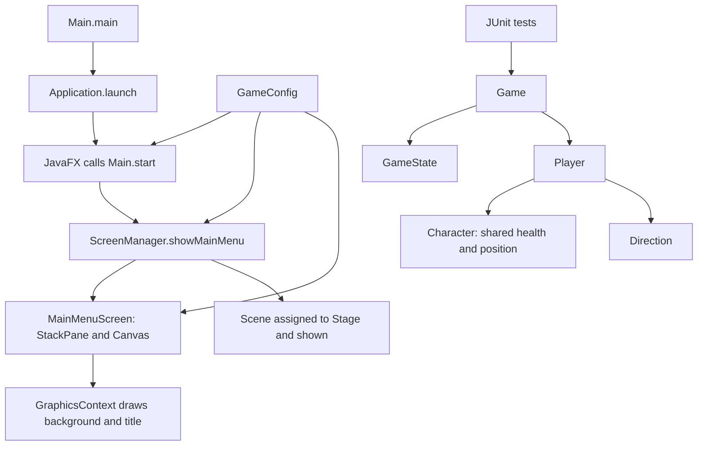
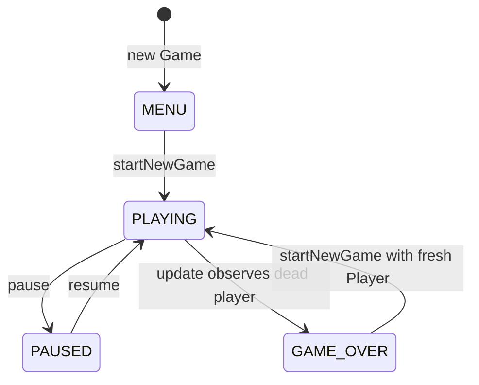

# Shadow Quest: The Lost Realm
# Java project technical documentation and learning report

Updated for Phase 2.4 on November 14, 2026; earlier dated results remain historical. This guide
explains each file, its actual Java concepts, and its connections to other files.
The development history follows the learning sections. Plans describe intended
features; only source code and observed verification establish implemented work.

## Learning guide contents

1. [Scope and vocabulary](#scope-and-vocabulary)
2. [Folders and supporting files](#folders-and-supporting-files)
3. [Production Java files](#production-java-files)
4. [Class connections and execution](#class-connections-and-execution)
5. [Test files and JUnit 5](#test-files-and-junit-5)
6. [Consolidated Java concepts](#consolidated-java-concepts)
7. [Viva preparation](#viva-preparation)
8. [Current verification](#current-verification)
9. [Development history](#development-history)
10. [Phase 2.1 launch diagnosis](#phase-21-javafx-launch-verification-and-diagnosis)
11. [Phase 2.2 Canvas foundation](#phase-22-static-canvas-title-screen)
12. [Phase 2.3 loop foundation and new Java files](#phase-23-animationtimer-game-loop-foundation)
13. [Phase 2.4 input and movement](#phase-24-keyboard-input-and-player-movement)

## Scope and vocabulary

There are thirteen production Java files: eleven classes and two enums. There are
seven test Java files, with one additional nested test-only class inside
CharacterTest. The implemented scope is the title-screen foundation plus game
states, character health/statistics, coordinates, and player movement calculations.
The static title has no loop. Enter opens a separate movement screen with a fresh Game; WASD and arrow keys move a temporary circle.

Phase 2.1 verified the actual JavaFX title window and normal window close locally.
The previous Windows Application Control error did not recur in that run.
This is not yet a playable game. The core
foundation is only a subset of the broader Phase 1 described in PROJECT_PLAN.md.

| Term | Meaning and example |
| --- | --- |
| Class | Definition of an object's data and operations, such as Player |
| Object | Instance created from a class, such as new Player("Arin") |
| Field | Variable belonging to an object or class, such as health |
| Local variable | Variable inside a method or constructor, such as distance in move |
| Method | Named operation, such as heal(double amount) |
| Constructor | Initialization code used when creating an object; it has no return type |
| Reference | Value identifying an object; Game.player refers to a Player |
| null | Absence of an object reference; player is null before a game starts |
| Domain logic | Rules/data that do not require a window, such as health calculations |
| API contract | The permitted inputs, outputs, and behavior of an operation |
| void | A method returns no value, although it may change state |
| Finite double | A floating-point number that is neither infinity nor NaN, meaning not-a-number |

## Folders and supporting files

Paths in inventory tables are relative to `C:\java game`. Java subsections also
provide complete local paths. Packages separate Java names and responsibilities;
they are not independent applications or Maven modules.

### Package inventory

All production packages are under `src/main/java/com/shadowquest/`.

| Folder | Actual contents | Responsibility/status |
| --- | --- | --- |
| app | Main.java | Implemented JavaFX entry point |
| core | Game.java, GameConfig.java, GameState.java, FrameClock.java, GameLoop.java | Session coordination, constants, state vocabulary, timing, and JavaFX loop adapter |
| ui | ScreenManager.java, MainMenuScreen.java, GameScreen.java | Static title, movement screen, navigation and loop/input lifecycle |
| player | Character.java, Player.java, .gitkeep | Implemented health and movement foundation; no combat/inventory |
| utils | Direction.java, .gitkeep | Shared movement enum; no collision helper yet |
| enemy | .gitkeep only | Reserved for enemies |
| items | .gitkeep only | Reserved for items, inventory, and collection |
| levels | .gitkeep only | Reserved for level models and progression |
| input | InputHandler.java, .gitkeep | Held-key tracking and horizontal/vertical input axes |
| render | .gitkeep only | Reserved for Canvas world rendering and assets |
| persistence | .gitkeep only | Reserved for saving and loading domain data |

`src/main/resources/` contains `styles/launch.css`. Its `images/`, `maps/`,
and `audio/` folders contain only `.gitkeep` markers. No game art/audio is present.

Under `src/test/java/com/shadowquest/`, `core/` contains GameTest.java and FrameClockTest.java and
`player/` contains CharacterTest.java, PlayerTest.java, and .gitkeep. The test
folders enemy, items, levels, and persistence contain only .gitkeep markers.

Git does not preserve empty directories. A `.gitkeep` is an empty conventionally
named file that lets a folder be committed. It is not a Java class or stub.
All 16 markers remain, including harmless markers in now-populated packages.

### Build configuration: pom.xml

POM means Project Object Model. Maven reads this XML file to identify the project,
obtain libraries, compile Java, and run tests. A dependency is a library; a plugin
performs a build task.

| Setting | Actual value and meaning |
| --- | --- |
| groupId | com.shadowquest, the project's group namespace |
| artifactId | shadow-quest-lost-realm, the build artifact name |
| version | 0.1.0-SNAPSHOT, a development version |
| maven.compiler.release | 21, the Java language/API target used by compilation |
| Source/report encodings | UTF-8, an explicit text encoding |
| javafx.version | 21.0.13, the pinned JavaFX library version |
| junit.version | 5.13.4, the pinned test library version |

`javafx-controls` provides controls such as Label and transitively brings in
JavaFX graphics/base. MainMenuScreen now uses Canvas from graphics.
`junit-jupiter` has test scope, so JUnit is used to compile
and run tests rather than as an application dependency.

The compiler plugin 3.14.0 compiles Java; Surefire 3.5.3 runs tests; the JavaFX
plugin 0.0.8 launches `com.shadowquest.app.Main` for `javafx:run`. `clean`
removes target output. `compile` compiles production code. `test` includes
compilation and then runs tests. There is no module-info.java, multi-module Maven
build, FXML dependency, Swing usage, database, or third-party game engine.

### Every supporting file and its purpose

| Repository-relative file | Explanation |
| --- | --- |
| src/main/resources/styles/launch.css | `.launch-screen` uses background #171b2e. `.game-title` uses System font, size 36px, bold weight, #f3e6bf text, and centered text alignment. Historical style resource retained unchanged; the Canvas screen no longer loads it. Its colors and font were transferred to drawing constants. |
| mvnw | Official Unix Maven Wrapper launcher 3.3.4. Reads wrapper properties, downloads Maven if absent, then forwards the requested command. README uses `sh ./mvnw`. |
| mvnw.cmd | Official Windows wrapper launcher using batch/PowerShell logic. Forwards commands to Maven. Credential-variable names in the script do not contain stored credentials. |
| .mvn/wrapper/maven-wrapper.properties | Pins wrapper 3.3.4, only-script distribution, and Maven 3.9.11 via HTTPS Maven Central. There is no pinned distribution checksum in this file. |
| .gitignore | Excludes target, .tools, caches, IDE files, packaged binaries, logs, temporary files, and local secret/key files. Includes a wrapper-JAR exception, though this wrapper uses no JAR. Ignore rules do not replace staged-file review. |
| .gitattributes | Uses automatic text handling, explicit LF for mvnw and CRLF for mvnw.cmd, preventing inappropriate wrapper line endings on different operating systems. |
| .github/PULL_REQUEST_TEMPLATE.md | Review prompts for behavior, tests, contracts, and asset attribution. It is not an automated CI workflow. |
| README.md | Prerequisites, build/run commands, structure, current scope, and troubleshooting. |
| CONTRIBUTING.md | Five-member responsibilities, fork/branch/PR process, tests, and report-maintenance rules. |
| docs/PROJECT_PLAN.md | Original game objectives, phases, story, team roles, and completion criteria. A planned feature is not automatically implemented. |
| docs/ARCHITECTURE.md | Original package boundaries, proposed APIs, rendering/threading conventions, and future designs. |
| docs/INITIALIZATION.md | Historical Phase 0 inventory and environment evidence. Its zero-test statement describes Phase 0 at that time. |
| docs/IMPLEMENTATION_LOG.md | Phase 1 contracts, decisions, tests, limitations, and continuation checks. |
| docs/PROJECT_DEVELOPMENT_REPORT.md | This learning guide and permanent development record. |

Generated `target/` contains class files and Surefire reports. Ignored `.tools/`
contains the portable JDK, Maven, dependency caches, and audit artifacts. Neither
belongs in the source commit. `.git/` is local Git metadata, not an application
resource or a normal committed project file.

## Production Java files

Phase 2.4 below documents every new/modified Java file and its current method
contracts. It supersedes earlier four-direction and disconnected-input details.

The Phase 2.3 section provides the complete file-by-file explanations for the
new FrameClock.java and GameLoop.java, plus FrameClockTest.java. Existing files
are described here; ScreenManager includes its Phase 2.3 lifecycle changes.

### Main.java

#### A. File information

Exact path: `C:\java game\src\main\java\com\shadowquest\app\Main.java`.
Declaration: `public final class Main extends Application` in the app package.
It provides the JavaFX entry point and delegates layout work to the UI package.

#### B. Code explanation

There are no fields or explicit constructors. Java supplies a public no-argument
constructor, allowing the JavaFX launcher to create the application object.

| Method | Parameters and return type | Working |
| --- | --- | --- |
| main | String[] args; public static void | Forwards command-line arguments to inherited launch(args). It does not call start directly. |
| start | Stage stage; public void | Receives JavaFX's primary window, sets its title from GameConfig.TITLE, constructs ScreenManager with that Stage, and calls showMainMenu. |

Stage means the top-level window. stage is a parameter, not a field.
`new ScreenManager(stage).showMainMenu()` creates an object and immediately calls
one of its methods. JavaFX invokes start on its Application Thread, which is used
for UI operations. No Game object or game loop is created here.

#### C. Java concepts used

| Concept | Meaning, actual example, and reason |
| --- | --- |
| Class/object | Main defines startup behavior; JavaFX constructs it. `new ScreenManager(stage)` creates a separate presentation object. |
| Inheritance | `extends Application` makes Main a JavaFX application and gives access to launch. |
| Method overriding | `@Override public void start(Stage stage)` implements the framework's startup operation. The annotation lets the compiler check the override. |
| Framework polymorphism | JavaFX invokes Main's overridden start method through its application lifecycle. This is actual runtime method selection; enemy polymorphism remains planned. |
| Static | main belongs to the class and can be called without first constructing Main in user code. |
| Final | `final class Main` cannot be subclassed; it does not make all referenced objects immutable. |
| Packages/imports | app groups startup code; imports identify GameConfig, ScreenManager, Application, and Stage. |
| JavaFX | Application and Stage define the GUI lifecycle. No custom button or keyboard event handling exists here. |

### GameConfig.java

#### A. File information

Exact path: `C:\java game\src\main\java\com\shadowquest\core\GameConfig.java`.
Declaration: `public final class GameConfig`. Shared window settings avoid
repeating the title and scene dimensions across UI files.

#### B. Code explanation

| Field | Type/modifiers | Value and use |
| --- | --- | --- |
| TITLE | public static final String | "Shadow Quest: The Lost Realm", used for the Stage title and Canvas text |
| VIEWPORT_WIDTH | public static final int | 960, passed to the Scene constructor |
| VIEWPORT_HEIGHT | public static final int | 600, passed to the Scene constructor |

`private GameConfig()` prevents other classes from constructing instances.
Its empty body is intentional for a constants-only class. There are no ordinary
methods. The dimensions describe the initial scene area, not native window
borders, and the code does not disable resizing.

#### C. Java concepts used

| Concept | Meaning, actual example, and reason |
| --- | --- |
| Static | `GameConfig.TITLE` is available without creating an object. |
| Final fields | The title and dimensions cannot be reassigned after initialization; there is no mutable global session state here. |
| Access control | Public exposes constants; the private constructor prevents unnecessary instances. |
| Constructor | The private constructor controls how the class may be used, despite having no statements. |
| Final class | Prevents extending a class designed only to group constants. |
| Types/package | String holds text, int holds whole-number dimensions; the class is in core and needs no explicit imports. |

There is no configuration-file loader or tile-size field in this implementation.

### GameState.java

#### A. File information

Exact path: `C:\java game\src\main\java\com\shadowquest\core\GameState.java`.
Declaration: `public enum GameState`. It defines session-state names without
allowing arbitrary string values.

#### B. Code explanation

| Constant | Current meaning |
| --- | --- |
| MENU | Initial state; no Player yet |
| PLAYING | Active session; update may detect death |
| PAUSED | Session preserved, with no Game.update processing |
| GAME_OVER | Player defeat detected; restarting is permitted |
| VICTORY | Declared for later progression work; currently unreachable through Game's API |

The enum declares no custom fields, constructors, or methods. Game compares its
values using `==`. It defines state vocabulary, not transition rules or screens.

#### C. Java concepts used

An enum is a type with a fixed set of named values. In Game,
`private GameState state = GameState.MENU;` cannot be assigned `"Playng"`.
This gives compiler-checked state names. Public allows other packages to use
the enum; the core package places it beside its main consumer, Game.

### Game.java

#### A. File information

Exact path: `C:\java game\src\main\java\com\shadowquest\core\Game.java`.
Declaration: `public class Game`. It coordinates one session independently of
JavaFX, making the rules testable without opening a window.

#### B. Code explanation

| Field | Type | Purpose |
| --- | --- | --- |
| state | private GameState | Initialized to MENU; records the current session state |
| player | private Player | Current player reference; initially null through Java's default field initialization |

There is no explicit constructor. Java supplies `public Game()`; every new
instance has its own fields. No static shared player or session state exists.

| Method | Parameters / return | Working |
| --- | --- | --- |
| getState | none / GameState | Returns the current state |
| getPlayer | none / Player | Returns the actual player reference, or null before start; not a copy |
| movePlayer | int horizontal, int vertical, double deltaTime / void | Delegates to Player.move only in PLAYING; other states ignore the movement command |
| startNewGame | none / void | From MENU or GAME_OVER, creates new Player("Arin") and then sets PLAYING; otherwise leaves state/player unchanged |
| pause | none / void | Changes PLAYING to PAUSED; other states are unchanged |
| resume | none / void | Changes PAUSED to PLAYING; other states are unchanged |
| update | double deltaTime / void | Validates finite, non-negative elapsed seconds, then detects death only while PLAYING |

The important condition is:

```java
if (state == GameState.PLAYING && !player.isAlive()) {
    state = GameState.GAME_OVER;
}
```

`&&` short-circuits: Java evaluates the second expression only if the first is
true. In MENU, it does not call isAlive on the null player. startNewGame creates
the player before entering PLAYING, and there is no public setState that bypasses
this sequence.

Zero elapsed time is valid. Invalid time throws before any state change, even
when paused. update currently validates deltaTime without using it to simulate
movement. It is a callable step, not an AnimationTimer or complete game loop.

Damage does not notify Game immediately. A playing update detects death later.
Pause/resume keep the same Player; restart creates a different Player. Calling
start while already playing or paused cannot erase the current session.

#### C. Java concepts used

| Concept | Meaning, actual example, and reason |
| --- | --- |
| Encapsulation | Private state/player prevent direct assignment; public operations enforce transitions. The returned Player remains mutable through its own methods. |
| Class/object and has-a relationship | `player = new Player("Arin")` creates the session's player; Game coordinates Player rather than extending it. |
| Default constructor | `new Game()` works without an explicitly written constructor. Field initialization creates the starting state. |
| Enum | `state == GameState.PAUSED` compares a defined state value. |
| Conditional logic | if, logical OR, logical AND, and negation implement guards; short-circuit evaluation avoids a null-player call. |
| Exception validation | IllegalArgumentException rejects invalid deltaTime. No try/catch recovery or exception for ordinary death is used. |
| Packages/imports | Game imports Player. GameState is in the same package and needs no import. There are no JavaFX imports. |

No getCurrentLevel, victory trigger, return-to-menu operation, or input handler
is implemented. These remain later integration work.

### Character.java

#### A. File information

Exact path: `C:\java game\src\main\java\com\shadowquest\player\Character.java`.
Declaration: `public abstract class Character`. This is the project's shared
character model, not `java.lang.Character`, the standard wrapper for a char.
It avoids duplicating health and position logic in Player and future character types.

#### B. Code explanation

| Field | Type/modifiers | Why it exists |
| --- | --- | --- |
| name | private final String | Nonblank character name with surrounding whitespace stripped |
| maxHealth | private final double | Positive upper health bound; double permits fractional health |
| attackPower | private final int | Non-negative whole-number statistic; no combat calculation yet |
| defense | private final int | Non-negative statistic; does not reduce incoming damage yet |
| health | private double | Current health, initially equal to maxHealth |
| x | private double | Horizontal world coordinate, initially 0.0 |
| y | private double | Vertical world coordinate, initially 0.0 |

The protected constructor takes `String name`, `double maxHealth`,
`int attackPower`, and `int defense`. It rejects null/blank names, non-positive
or non-finite maximum health, and negative attack/defense. The null-or-blank
condition short-circuits before calling a method on null.

`this.name = name.strip()` stores a trimmed name. `this` distinguishes a field
from its same-named parameter. health starts at maxHealth; x and y use Java's
default zero initialization. A constructor has no return type.

Every getter takes no parameters:

| Method | Return type | Returned value |
| --- | --- | --- |
| getName | String | name |
| getHealth | double | health |
| getMaxHealth | double | maxHealth |
| getAttackPower | int | attackPower |
| getDefense | int | defense |
| getX | double | x |
| getY | double | y |

| Other method | Parameters / return | Working |
| --- | --- | --- |
| isAlive | none / boolean | Returns health > 0; there is no separate alive flag that could disagree with health |
| takeDamage | double amount / void | Validates input, then assigns Math.max(0, health - amount) |
| heal | double amount / void | Validates input, then adds Math.min(amount, maxHealth - health) |
| moveBy | double deltaX, double deltaY / protected final void | Computes nextX/nextY, rejects non-finite results, then assigns both coordinates |
| validateHealthAmount | double amount / private static void | Shared validation for damage/healing: rejects negative numbers, NaN, and infinities |

Damage of 30 from health 100 leaves 70. Healing by 50 then adds only 30,
restoring 100. Damage beyond remaining health stops at zero. Zero damage/healing
is valid. Invalid values are rejected before mutation.

heal limits the addition before adding. Adding two enormous doubles first could
overflow to infinity; limiting to `maxHealth - health` avoids that intermediate
overflow. A dedicated test uses Double.MAX_VALUE to check it.

moveBy validates both new coordinates before assigning either. If Y is invalid,
X must also remain unchanged. This is an all-or-nothing validation sequence,
not a claim of thread safety; there is no synchronization in these classes.

Healing from zero is allowed. isAlive then becomes true, but Game.state does
not change automatically. This is a health primitive, not a resurrection item.

#### C. Java concepts used

| Concept | Meaning, actual example, and reason |
| --- | --- |
| Abstraction | `abstract class Character` cannot be directly instantiated. It provides a common model with working methods; abstract classes do not need abstract methods. |
| Encapsulation | health/x/y are private. Getters expose values while takeDamage, heal, and moveBy enforce rules. |
| Inheritance support | The protected constructor and moveBy support subclasses. Player reuses the logic but cannot directly access private fields. |
| Access modifiers | Public exposes operations, private hides fields/helpers, protected supports subclasses and same-package access. CharacterTest can call moveBy because it is in the same package. |
| Final | Final identity/stat fields cannot be reassigned. Final moveBy cannot be overridden to remove validation. health/x/y remain mutable. |
| Static helper | validateHealthAmount depends only on amount, so it needs no object state and is static. |
| Constructors and this | `this.maxHealth = maxHealth` initializes a field from the validated parameter. |
| Exceptions/numeric logic | IllegalArgumentException reports invalid input; Math.min/Math.max and Double.isFinite protect bounds. Ordinary damage and death do not throw. |
| Package | Character belongs to player. String, Math, and Double come from automatically available java.lang. |

The proposed attack and per-character update methods are absent, not empty stubs.

### Player.java

#### A. File information

Exact path: `C:\java game\src\main\java\com\shadowquest\player\Player.java`.
Declaration: `public class Player extends Character`. It adds player defaults
and movement while reusing shared character behavior.

#### B. Code explanation

| Field | Type/modifiers | Purpose |
| --- | --- | --- |
| INITIAL_MAX_HEALTH | private static final double, 100 | Starting maximum health |
| INITIAL_ATTACK_POWER | private static final int, 10 | Starting attack statistic |
| INITIAL_DEFENSE | private static final int, 5 | Starting defense statistic |
| MOVEMENT_SPEED | private static final double, 200 | Initial world units per second |
| speed | private final double | The player's fixed movement rate, assigned from MOVEMENT_SPEED |

These are starter tuning values, not a completed combat-balance design.
`public Player(String name)` calls
`super(name, INITIAL_MAX_HEALTH, INITIAL_ATTACK_POWER, INITIAL_DEFENSE)` and
then assigns speed. The parent constructor validates shared data. Player does
not declare a second copy of health or position.

| Method | Parameters / return | Working |
| --- | --- | --- |
| getSpeed | none / double | Returns speed |
| move | Direction direction, double deltaTime / void | Validates inputs, calculates distance, skips dead-player movement, and calls inherited moveBy for the selected direction |

The Direction overload rejects null and maps UP/DOWN/LEFT/RIGHT to axes
(0,-1)/(0,1)/(-1,0)/(1,0), then delegates to move(int,int,double).
The digital-axis overload validates axes in [-1,1], elapsed time, and finite
distance. Dead players and zero input do not move. Otherwise it divides both
axes by Math.hypot(horizontal, vertical) and multiplies each normalized component
by speed * deltaTime before calling inherited moveBy. This preserves the old
cardinal behavior and gives diagonals the same total speed. See Phase 2.4 for
all method contracts and examples.

At speed 200, RIGHT for 0.25 seconds changes X by 50. Ten steps of 0.1 seconds
travel the same distance as one step of 1 second, within floating-point precision.
This prevents speed from depending on how often move is called.

Zero time gives no displacement. A valid distance can still overflow when added
to a huge coordinate, which moveBy catches. Negative coordinates are allowed
until boundaries/collisions exist. Dead players still reject invalid arguments.

#### C. Java concepts used

| Concept | Meaning, actual example, and reason |
| --- | --- |
| Inheritance | `extends Character` reuses health and position methods; `player.takeDamage(30)` calls the inherited implementation. |
| Constructor chaining | super initializes the parent part before speed is assigned. |
| Encapsulation | Private final speed is exposed through getSpeed; positions change through move instead of public coordinate setters. |
| Static/final | Named constants define defaults once; speed cannot be reassigned after construction. |
| Enum/switch | Direction restricts choices; arrow switch cases choose displacement without fall-through. |
| Exception validation | IllegalArgumentException rejects invalid direction/time and distance overflow. |
| Packages/imports | Imports Direction from utils. Character is in the same package. There is no Game or JavaFX import. |

Player overrides no methods. Phase 2.4 adds the move(int, int, double) overload; the original Direction overload delegates to it. Inheriting heal
is different from overriding it. Weapons, inventory, and animations are not present. Input handling lives in InputHandler, outside Player.

### Direction.java

#### A. File information

Exact path: `C:\java game\src\main\java\com\shadowquest\utils\Direction.java`.
Declaration: `public enum Direction`. It gives movement a shared type without
coupling Player to JavaFX key codes.

#### B. Code explanation

The constants are UP, DOWN, LEFT, and RIGHT. There are no custom fields,
constructors, or methods. Direction does not store vectors; Player maps these values to digital axes and delegates to its normalized movement overload.

Example: `player.move(Direction.RIGHT, 0.25)`. The String `"RIGHT"` cannot be
passed directly. Null is still possible for a reference, so Player checks it.

#### C. Java concepts used

An enum defines a fixed set of named values, letting the compiler check the
argument type. Public exposes it across packages; utils places it in shared code.
Direction.RIGHT is the concrete example used in movement tests. It is not a
keyboard binding or event handler.

### ScreenManager.java

#### A. File information

Exact path: `C:\java game\src\main\java\com\shadowquest\ui\ScreenManager.java`.
Declaration: `public final class ScreenManager`. It separates scene presentation
from Main. Title and movement-demo scenes are managed; see the Phase 2.4 method/lifecycle details below.

#### B. Code explanation

`private final Stage stage` stores the window passed by Main.
`public ScreenManager(Stage stage)` assigns `this.stage = stage`. It does not
create a second Stage or validate null; the startup caller supplies JavaFX's Stage.

Phase 2.3 adds `private GameLoop gameLoop`, initially null. The constructor also
registers a scene-property change listener and a WINDOW_HIDDEN event handler;
both call stopGameLoop(). showMainMenu() now stops the active loop before replacing
the scene. The title itself never starts a loop.

`public void startGameLoop(DoubleConsumer update, Runnable render)` returns void.
It stops/releases the previous loop, creates one GameLoop from the callbacks,
and starts it. Future gameplay code must call it after installing its Scene.
Repeated calls replace the previous timer rather than running two together.
`public void stopGameLoop()` returns void, stops a non-null timer and clears its
reference; repeated calls are harmless. These operations belong on the JavaFX
Application Thread. The constructor listeners use lambdas and JavaFX property/
event APIs. No new custom interface or game rule is introduced. See Phase 2.3
below for the full timing and lifecycle explanation.

`public void showMainMenu()` takes no parameters. It constructs MainMenuScreen,
creates local `Scene scene` with that root and GameConfig's dimensions, sets it
on the Stage, and calls stage.show(). A Scene contains the UI tree inside a
Stage; it is not a game level or GameState.

Repeated menu calls create another title Scene. There is no scene cache. Phase 2.4 showGame creates a fresh Game and calls startNewGame; the complete current API is documented below.

#### C. Java concepts used

| Concept | Meaning, actual example, and reason |
| --- | --- |
| Objects/references | The constructor receives an existing Stage and showMainMenu creates a Scene and MainMenuScreen. Objects collaborate through references. |
| Encapsulation | Private stage is used through the public presentation operation. |
| Constructor/this | `this.stage = stage` stores the argument for later use. |
| Final | Final class prevents subclasses; final stage prevents replacing the reference, not changing the referenced window. |
| JavaFX | Stage owns the window; Scene owns its content. Main calls the method during JavaFX startup. |
| Packages/imports | Imports GameConfig, Scene, Stage; MainMenuScreen needs no import because it is also in ui. |

### MainMenuScreen.java

#### A. File information

Exact path: `C:\java game\src\main\java\com\shadowquest\ui\MainMenuScreen.java`.
Declaration: `public final class MainMenuScreen extends StackPane`.
This screen owns the static Canvas title drawing and its layout. ScreenManager
creates it as the Scene root. It reads GameConfig but does not access Game,
Character, or Player. No buttons or gameplay are implemented.

#### B. Code explanation

| Field | Type and modifiers | Purpose |
| --- | --- | --- |
| BACKGROUND_COLOR | private static final Color | Shared dark fill, #171b2e |
| TITLE_COLOR | private static final Color | Shared pale title fill, #f3e6bf |
| TITLE_FONT | private static final Font | System bold font, size 36, matching the former CSS |
| canvas | private final Canvas | One drawing surface per screen, initially sized from GameConfig.VIEWPORT_WIDTH and VIEWPORT_HEIGHT |

Static fields belong to the class. The final Canvas reference cannot be replaced,
but its dimensions and pixels can change. The colors and font are presentation
settings and stay in the UI class; GameConfig remains the source of initial
window dimensions and the title string.

| Constructor/method | Parameters and return | Working and purpose |
| --- | --- | --- |
| public MainMenuScreen() | No parameters; constructor has no return type | Sets the pane's preferred size from GameConfig, marks Canvas unmanaged, adds it to getChildren(), and calls drawTitle() |
| protected layoutChildren() | No parameters; void; @Override | Calls super.layoutChildren(), compares actual pane and Canvas dimensions, and resizes/redraws only when they differ |
| private drawTitle() | No parameters; void | Reads Canvas width/height, obtains GraphicsContext, fills the background rectangle, sets font/color/alignment, and draws the title at the center |

Construction creates a 960 x 600 Canvas through the GameConfig constants.
`canvas.setManaged(false)` excludes it from StackPane's automatic child sizing;
MainMenuScreen sizes it explicitly in layoutChildren. It remains visible in the
child list and stays at the default origin (0, 0). This prevents the Canvas's
old size from controlling the pane's preferred/minimum layout size during resize.

JavaFX invokes layoutChildren during layout, including window size changes.
The override calls the superclass implementation first. If width or height has
changed, it sets both Canvas dimensions and redraws to cover the new drawing
area and recenter the title. There is no AnimationTimer, frame loop, input handler,
or domain update in this callback.

Inside drawTitle, local `double width` and `double height` hold the actual Canvas
size, and local `GraphicsContext graphics` is its 2D drawing interface.
`fillRect(0, 0, width, height)` covers the whole Canvas with the background color.
After changing fill and font, the code sets `TextAlignment.CENTER` and
`VPos.CENTER`. `fillText(GameConfig.TITLE, width / 2, height / 2, width)` places the
text's horizontal center and vertical alignment center at the Canvas midpoint.
At 960 x 600, that point is (480, 300). Both dimensions are doubles, so division
preserves fractional coordinates. Center alignment is needed because merely
passing half-width with the default left alignment would start the title there.
The last width argument limits the drawn text width; JavaFX can compress long
text into narrow space. This is a single line, not the former Label's wrapping.

Canvas coordinates start at the top-left, with positive X right and positive Y
down. These are drawing coordinates, not a new player-position system.
The background and title are both Canvas drawing operations. launch.css is no
longer loaded; its unchanged file remains as the historical title style resource.
Editing that CSS will not change this Canvas screen.

#### C. Java concepts used

| Concept | Actual example, meaning, and reason |
| --- | --- |
| Class/object and composition | The screen owns a Canvas object; it gets the Canvas's GraphicsContext rather than creating a separate rendering service |
| Inheritance | extends StackPane reuses a JavaFX layout node and its child collection |
| Overriding and polymorphism | @Override layoutChildren supplies this screen's layout behavior when JavaFX invokes the inherited lifecycle contract |
| Encapsulation/access modifiers | private canvas and drawTitle keep drawing details inside the UI; public construction remains the ScreenManager entry point; protected layoutChildren matches the framework extension point |
| Constructor | MainMenuScreen() creates a ready-to-display screen with an initial drawing |
| Static/final | Shared Color/Font constants and a fixed per-screen Canvas reference express stable ownership; final does not make Canvas immutable |
| Collections/generics | getChildren().add(canvas) adds a Canvas subtype to the inherited ObservableList<Node>; no inventory collection is implied |
| Enums | FontWeight.BOLD, TextAlignment.CENTER, and VPos.CENTER select defined JavaFX options without strings |
| Local variables/arithmetic | double width/height and division by 2 compute the current midpoint |
| Conditions | The size comparison avoids repainting on unchanged layout passes |
| Separation of responsibilities | Main starts JavaFX, ScreenManager presents screens, and this class draws; domain rules remain outside JavaFX |

A Canvas is a JavaFX scene-graph node containing a drawing surface.
GraphicsContext is the object used to issue drawing commands and set drawing
state such as fill color, font, and alignment. It is not a window or a game
controller. Stage is the native window, Scene holds the node tree, StackPane is
the layout root, and Canvas is its child.

A Label is an ordinary control with text properties, CSS styling, wrapping, and
accessibility behavior supplied by JavaFX. Canvas stores drawing output; its
painted title is not a separate Label node. Changing a game value or CSS does
not automatically repaint those pixels. Here redraw is explicit at construction
and resize. This small static screen needs no renderer abstraction or new class;
the reserved render package remains for future world rendering.

## Class connections and execution

### Foundation startup and domain paths



This diagram shows the original startup/domain foundation. Phase 2.4 now connects these paths through ScreenManager.showGame and InputHandler; the complete current flow is in the Phase 2.4 section. Direction itself remains independent of key events.

ScreenManager calls the MainMenuScreen constructor and attaches its resulting
node to a Scene. MainMenuScreen reads GameConfig and draws through GraphicsContext. These UI classes
do not calculate health or movement; ScreenManager now passes input axes to Game. Game creates a Player; Player delegates
shared initialization and position changes to Character.

### Current transition rules



VICTORY exists in the enum but has no implemented incoming transition. There is
no return-to-menu operation. The fuller screen-flow diagram in ARCHITECTURE.md
describes future behavior, not this completed set of operations.

### Worked domain example

This example combines existing method calls. It is not an extra source file or
the current application's automatic startup flow.

```java
Game game = new Game();
game.startNewGame();
Player arin = game.getPlayer();
arin.move(Direction.RIGHT, 0.25);
arin.takeDamage(30);
arin.heal(10);
game.pause();
game.update(0.016);
game.resume();
arin.takeDamage(1000);
game.update(0.016);
game.startNewGame();
```

Step by step:

1. new Game starts in MENU with no Player.
2. startNewGame creates Arin at health 100 and coordinates `(0, 0)`.
3. Moving RIGHT for 0.25 seconds adds `200 * 0.25 = 50` to X.
4. Damage 30 leaves health 70; healing 10 raises it to 80.
5. pause changes the state to PAUSED. The next update validates time but does
   not process defeat or other game rules.
6. resume changes back to PLAYING. Damage 1000 clamps health to zero.
7. The next update sees isAlive is false and enters GAME_OVER.
8. startNewGame constructs a fresh Player with full health at the origin.

The local variable arin still refers to the previous Player after restart.
Use game.getPlayer again to obtain the new one. A returned object reference is
not automatically redirected when the field that originally supplied it changes.

Player does not know Game.state. Direct calls such as arin.move while paused
can still move a living player. The new Game.movePlayer command restricts
movement calls to PLAYING. This separation keeps Player independent of sessions
and JavaFX; ScreenManager now routes movement through that gated command.

## Test files and JUnit 5

Tests create domain objects and compare results with expectations. They are not
game screens. Maven Surefire discovers the seven test classes and runs JUnit.
No test starts JavaFX, sleeps for animation, or requires a rendered window.

### Common JUnit concepts actually used

| Construct | Meaning | Actual example and purpose |
| --- | --- | --- |
| @Test | Marks an ordinary test method | GameTest.startsNewGameWithArin checks starting a session |
| @ParameterizedTest | Runs one method repeatedly with supplied arguments | PlayerTest.movesInEachWorldDirection checks four directions |
| @ValueSource | Supplies one argument per execution | Invalid-time tests receive -1, NaN, and infinities |
| @NullAndEmptySource | Supplies null and an empty value | Name tests check both absent and empty names |
| @CsvSource | Supplies comma-separated argument rows | `"UP, 0, -50"` supplies Direction and expected coordinates |
| assertEquals | Checks expected and actual values | Health after damage must equal 69.5 in CharacterTest |
| assertTrue/assertFalse | Check boolean conditions | isAlive must be false after lethal damage |
| assertNull/assertNotNull | Check reference presence | Game has no player before start and has one afterwards |
| assertSame/assertNotSame | Check whether references identify the same object | Pause preserves the player; restart replaces it |
| assertThrows | Requires an operation to throw a particular exception | Invalid movement time must throw IllegalArgumentException |
| Numeric tolerance | Allows a small floating-point difference | Movement assertions use a delta of 0.000001 |
| Static imports | Allow calling static assertion methods without the Assertions prefix | `import static org.junit.jupiter.api.Assertions.*;` |
| Lambda expression | Supplies an operation to run later | `() -> player.move(null, 1)` is passed to assertThrows |

JUnit converts the CSV direction names into Direction values for the typed
parameter. It is test input conversion, not production string-based movement.
The lambda passed to assertThrows targets JUnit's Executable functional interface;
the project declares no custom gameplay interface. JUnit, not a project try/catch
block, catches and checks the expected exception.

Tests follow an arrange/act/assert pattern: create a known object, call an
operation, then check results. All test methods here return void. Classes and
methods are package-private, which JUnit 5 supports. The test classes declare no
fields or explicit outer-class constructors; they construct fresh objects in the
methods. There are no @BeforeEach hooks, disabled tests, mocks, or custom runners.

### GameTest.java

#### A. File information

Exact path: `C:\java game\src\test\java\com\shadowquest\core\GameTest.java`.
Class: `GameTest`, testing Game and its interactions with Player and GameState.
It protects session transitions and prevents accidental loss or sharing of state.

#### B. Code explanation and coverage

Important local variables are `Game game`, `Player player`, and
`Player previousPlayer`. They let tests observe both values and object identity.
The independent-session test uses `Game first` and `Game second`. The parameter
`double time` supplies invalid elapsed-time values.

All methods below return void. Only invalidTimeNeverChangesState has a parameter;
the others take none.

| Test method | Executions | Behavior and why it matters |
| --- | ---: | --- |
| beginsInMenuWithoutAPlayer | 1 | pause/resume/update do not start an unstarted game or dereference a null player |
| startsNewGameWithArin | 1 | Starting creates a living Arin and enters PLAYING |
| pauseAndResumePreserveTheSessionAndIgnoreRepeatedCommands | 1 | Repeated commands preserve state, health, position, and the same Player reference |
| startCannotReplaceAnActiveOrPausedSession | 1 | Repeated start cannot silently discard progress |
| updateLeavesLivingPlayerAndStateUnchanged | 1 | A living player remains in PLAYING; update does not invent movement or healing |
| deathBecomesGameOverOnUpdate | 1 | Death is observed on update; pause/resume cannot escape GAME_OVER |
| pausedUpdateDefersDeathDetectionUntilPlayingAgain | 1 | Even externally changed health is not processed by a paused update; resumed update detects it |
| healingCannotResumeAGameOverSession | 1 | Raising health on the old player cannot automatically resume the session |
| restartingAfterDefeatCreatesAFreshPlayer | 1 | Restart resets health/position and replaces the player; modifying the old player does not change the new one |
| invalidTimeNeverChangesState(double time) | 4 | -1, NaN, positive infinity, negative infinity throw without changing MENU, PLAYING, or PAUSED |
| separateGamesDoNotSharePlayerOrState | 1 | Defeat in one Game does not affect a separate Game |

There are 11 test methods and 14 executions. Testing both returned values and
reference identity matters: a replacement Player with similar values would still
break the promise that pausing preserves the same session object.

#### C. Java concepts used

- **Objects and references:** `Player previousPlayer = game.getPlayer()` holds
  the old object so assertNotSame can verify replacement on restart.
- **Enums:** assertions compare GameState values, not arbitrary strings.
- **Packages/imports:** core groups the tests with Game; imports bring in Player,
  Direction, and JUnit annotations. Static imports shorten assertion calls.
- **Annotations/parameterized tests:** @ValueSource repeats one invalid-input
  check for four doubles, avoiding four duplicated test bodies.
- **Lambdas and exception verification:** `() -> game.update(time)` delays the
  call until assertThrows executes it. A missing exception causes test failure.
- **Encapsulation through public APIs:** tests use Game methods rather than
  directly setting its private state, so they check the behavior callers receive.

### CharacterTest.java

#### A. File information

Exact path: `C:\java game\src\test\java\com\shadowquest\player\CharacterTest.java`.
Class: `CharacterTest`, testing shared Character rules independently of Player's
fixed defaults. It includes `private static class TestCharacter extends Character`.

#### B. Code explanation and coverage

The nested TestCharacter declares no fields or ordinary methods. Its constructor
takes `String name`, `double maxHealth`, `int attackPower`, and `int defense`,
then calls super with those arguments. It makes the abstract base usable for
tests of custom maximum health and statistics without adding a production type.

Most methods use local `Character character = new TestCharacter(...)`. This is
a superclass reference to a subclass object. It demonstrates substitutability,
but does not demonstrate overridden enemy behavior because TestCharacter adds
no overrides. Same-package access permits calling protected moveBy directly.

All test methods return void. Parameters appear only where listed:

| Test method | Executions | Behavior and edge cases |
| --- | ---: | --- |
| initializesSharedPropertiesAndTrimsName | 1 | Custom stats, full health, origin, and stripped name are initialized correctly |
| rejectsMissingNames(String name) | 4 | Rejects null, empty string, space, and tab/newline-only name |
| rejectsInvalidMaximumHealth(double maxHealth) | 5 | Rejects zero, negative health, NaN, and both infinities |
| rejectsNegativeStats(int attack, int defense) | 2 | Rejects negative attack and negative defense separately |
| acceptsZeroAttackAndDefense | 1 | Zero is valid, preventing over-restrictive validation |
| damageAndHealingChangeHealthWithoutApplyingCombatStats | 1 | Fractional values produce health 69.5 then 79.75; defense is not silently applied |
| healthNeverExceedsMaximum | 1 | Oversized healing and further healing stop at maximum health |
| healingLargeHealthValuesDoesNotOverflow | 1 | A character with Double.MAX_VALUE maximum health remains finite after healing |
| zeroAmountsLeaveHealthUnchanged | 1 | Zero damage/healing are valid no-ops |
| invalidHealthAmountsAreRejectedWithoutMutation(double amount) | 4 | Negative, NaN, and infinite damage/healing throw and preserve health |
| lethalDamageClampsAtZeroAndMarksCharacterDead(double damage) | 3 | Exact lethal damage, overkill, and Double.MAX_VALUE leave zero health; repeated damage stays at zero |
| healingFromZeroRestoresHealth | 1 | Documents current health behavior: healing from zero makes isAlive true |
| invalidPositionChangesLeaveBothCoordinatesUnchanged(double invalid) | 3 | NaN and infinities in either axis reject the move without partially changing the other axis |
| positionOverflowLeavesBothCoordinatesUnchanged | 1 | Two large finite values can overflow when added; both coordinates must remain unchanged |

There are 14 test methods and 29 executions. These cases matter because merely
checking typical health values would miss NaN propagation, overflow, and partially
applied position changes.

#### C. Java concepts used

- **Abstraction/inheritance:** the abstract Character cannot be instantiated
  directly, so the small TestCharacter subclass supplies a concrete type.
- **Constructor chaining:** its constructor calls super to exercise the actual
  production validation, rather than duplicating it in the test.
- **Nested static class:** TestCharacter is private to the test and does not need
  an enclosing CharacterTest object to be created.
- **Superclass references:** a Character variable can hold TestCharacter. The
  inherited methods are the real Character implementations.
- **Access modifiers/packages:** tests in the player package can call protected
  moveBy; they still cannot access private health/x/y fields.
- **Annotations and data sources:** NullAndEmptySource, ValueSource, and CsvSource
  provide different invalid constructor/operation inputs.
- **Lambdas/exceptions:** assertThrows executes calls such as
  `() -> character.heal(amount)` and checks the exception type.
- **Floating-point limits:** Double.MAX_VALUE, Double.NaN, and infinity values
  exercise edge cases ordinary arithmetic examples would miss.

### PlayerTest.java

#### A. File information

Exact path: `C:\java game\src\test\java\com\shadowquest\player\PlayerTest.java`.
Class: `PlayerTest`, testing Player and inherited character behavior as used by
the player. It protects defaults, direction conventions, and time-based movement.

#### B. Code explanation and coverage

Most methods use local `Player player`. `Player oneStep` and `Player manySteps`
compare different movement schedules. `double largeTime` constructs a huge but
initially valid movement distance, and `double previousX` records the position
before a move that should fail. The `int i` loop counter repeats ten small steps.
There are no fields or explicit constructors in this class.

All test methods return void. Parameters appear only where listed:

| Test method | Executions | Behavior and why it matters |
| --- | ---: | --- |
| initializesPlayerWithDocumentedDefaults | 1 | Checks Arin's name, health/maxHealth, attack/defense, speed, origin, and alive state |
| rejectsInvalidPlayerNames(String name) | 4 | Inherited validation rejects null, empty, space, and tab/newline-only names |
| movesInEachWorldDirection(Direction direction, double expectedX, double expectedY) | 4 | A 0.25-second move produces UP `(0,-50)`, DOWN `(0,50)`, LEFT `(-50,0)`, RIGHT `(50,0)` |
| movementDependsOnElapsedTimeRatherThanNumberOfUpdates | 1 | One 1-second step equals ten 0.1-second steps |
| oppositeDirectionsReturnToStartingPosition | 1 | Equal movements around a rectangle return to the origin |
| zeroTimeDoesNotMovePlayer | 1 | Zero elapsed time cannot change position |
| rejectsInvalidOrOverflowingMovementTimeWithoutChangingPosition(double time) | 5 | Negative time, NaN, infinities, and Double.MAX_VALUE reject without mutation |
| rejectsNullDirectionWithoutChangingPosition | 1 | A missing direction throws and leaves position intact |
| repeatedLargeMovementCannotOverflowPosition | 1 | A second large move rejects coordinate overflow and preserves previousX |
| deadPlayerDoesNotMoveAndStillValidatesInput | 1 | Dead players stay put, but null direction and negative time still throw |

There are 10 test methods and 20 executions. The 0.000001 tolerance in movement
assertions accounts for floating-point rounding; it does not permit large errors.

#### C. Java concepts used

- **Objects/inheritance:** new Player exercises its constructor and inherited
  getHealth/takeDamage/isAlive operations through the public API.
- **Enums:** typed Direction inputs verify the actual movement contract.
- **Loop and primitive variables:** the `for (int i = 0; i < 10; i++)` loop checks
  whether dividing elapsed time into smaller updates changes total movement.
- **Parameterized tests:** CSV rows provide direction plus expected coordinates;
  ValueSource supplies invalid doubles; NullAndEmptySource checks absent names.
- **Lambdas/exception assertions:** assertThrows verifies invalid calls and the
  subsequent assertions verify that rejection did not corrupt position.
- **Packages/imports/static imports:** player groups tests with production code;
  imported JUnit methods make assertions readable without changing their behavior.

## Consolidated Java concepts

### Concepts currently implemented

This table distinguishes project-written behavior from use of library features.
Using a library method is real Java usage, but does not mean the project has
implemented an entire subsystem based on that concept.

| Java concept | Meaning | Implemented in | Status |
| --- | --- | --- | --- |
| Classes and objects | Define types and create independent instances | Main, Game, Player, UI classes, tests | Implemented |
| Encapsulation | Hide fields and control access through methods | Character health/position; Game state/player; Player speed | Implemented |
| Abstraction | Represent common behavior in a non-instantiable base | abstract Character | Implemented, with concrete shared methods |
| Inheritance | Reuse a base class's data/operations | Player extends Character; Main extends Application; MainMenuScreen extends StackPane; TestCharacter extends Character | Implemented |
| Method overriding | Supply a subclass implementation of an inherited method | Main.start(Stage) and MainMenuScreen.layoutChildren() with @Override | Implemented in framework callbacks; Player has no overrides |
| Polymorphism | Use a subtype through a base contract and dispatch overridden behavior | JavaFX lifecycle calls Main.start; Character references hold TestCharacter | Implemented at framework/type-substitution level; no enemy behavior hierarchy yet |
| Constructors and super | Initialize an object and its base portion | Player and TestCharacter call the Character constructor | Implemented |
| Access modifiers | Control visibility | Public APIs, private fields, protected Character constructor/moveBy, package-private tests | Implemented |
| Static | Member belongs to the class | Main.main, GameConfig constants, Player defaults, Character validation helper | Implemented |
| Final | Prevent reassignment or extension/override | Configuration/stat fields; final UI classes; final moveBy | Implemented; final references do not freeze objects |
| Enums | Restrict values to named alternatives | GameState, Direction, JavaFX TextAlignment.CENTER and VPos.CENTER | Implemented |
| Packages and imports | Organize names and reference other types | com.shadowquest packages and imports across all Java files | Implemented |
| Conditionals, switch, loops | Select or repeat behavior | Game guards; Player direction switch; PlayerTest ten-step loop | Implemented |
| Exception validation | Reject invalid arguments | Character, Player, Game throw IllegalArgumentException; tests use assertThrows | Implemented; no application try/catch recovery workflow |
| Collections/generics through JavaFX | Use typed lists of nodes or strings | MainMenuScreen getChildren().add(canvas) | Implemented library-list usage only |
| Lambda expressions | Supply a short operation as a value | assertThrows tests and ScreenManager cleanup listeners | Implemented |
| Functional-interface usage | Pass an implementation of a single-method contract | GameLoop DoubleConsumer update and Runnable render; JUnit Executable | Implemented using library interfaces; no custom gameplay interface |
| Annotations | Attach compiler/framework metadata | @Override, @Test, @ParameterizedTest and input-source annotations | Implemented |
| JavaFX scene graph | Build a hierarchy of UI nodes inside a window | Stage -> Scene -> MainMenuScreen -> Canvas | Implemented; Canvas title visually verified in Phase 2.2 |
| Canvas drawing | Paint pixels using drawing commands | MainMenuScreen.drawTitle and GraphicsContext | Implemented for static title and movement placeholder |
| AnimationTimer | Receive active-frame callbacks | GameLoop.handle(long now) | Implemented adapter; idle on title screen |
| try/finally | Run cleanup even when a callback throws | GameLoop.handle resets handlingFrame in finally | Implemented; does not suppress callback exceptions |
| Method overloading | Same method name with different parameters | Player.move(Direction, double) delegates to move(int, int, double) | Implemented |
| EnumSet collections | Store unique values of one enum type | InputHandler pressedKeys | Implemented for input; inventory remains planned |
| Keyboard/button events | Translate user actions into input or navigation | InputHandler filters; ScreenManager Enter; GameScreen return button | Implemented |
| Gameplay loop wiring | Connect timing, input, domain commands, and drawing | ScreenManager.showGame update lambda and screen::render | Implemented for movement demo |

### Concepts planned for future phases

| Java concept | Meaning | Intended location | Status |
| --- | --- | --- | --- |
| Enemy polymorphism/overriding | Different enemy types respond through a shared contract | Future Enemy subclasses | Planned; no Enemy classes exist |

| Domain collections | Store groups of items, enemies, and keys | Future Inventory, Level, progression code | Planned; do not count UI node lists as inventory |
| Gameplay interfaces | Define shared capabilities | Proposed Attackable and Collectable | Planned; no interface source files exist |
| File handling/persistence | Read and write saved domain state | Future persistence package | Planned; CSS lookup does not save game progress |
| Recoverable exception handling | Catch and handle I/O or malformed-save failures | Future persistence/resource boundaries | Planned; current validation throws and tests assert those exceptions |


| World rendering | Draw maps and entities through Canvas | Future render package | Planned; title and temporary player shape are implemented |

These are planned applications of concepts, not commitments to implement them
all in the next task. They remain subject to the project's phase approvals.

## Viva preparation

Use these answers as a starting point, then open the named files and explain the
actual expressions. Avoid claiming that future game systems already work.

**1. What does the project currently do?**

It has a static title and a keyboard-controlled Canvas movement demo. The model is connected to input through ScreenManager and GameLoop. Phase 2.1 verified
the title window, compilation, and domain tests. This is not a playable game
demonstration.

**2. Explain the architecture in about a minute.**

Main starts JavaFX and delegates to ScreenManager. ScreenManager creates a Scene
containing MainMenuScreen. GameConfig supplies shared window settings. Separately,
Game owns session state and a Player. Player extends Character for health and
position behavior and uses Direction for movement. Domain packages contain no
JavaFX imports, so their tests do not need a window. Reserved packages mark later
work, not completed modules.

**3. Why JavaFX instead of Swing?**

JavaFX is the team's agreed GUI framework and matches the planned Canvas renderer
and AnimationTimer loop. Current code uses Application, Stage, Scene, StackPane,
Canvas, and GraphicsContext. We have not implemented a Swing version or measured which is
faster, so we should not claim a performance comparison.

**4. Why use Maven and the wrapper?**

pom.xml declares versions, dependencies, compilation, testing, and JavaFX startup.
The wrapper pins Maven 3.9.11 so teammates can use the same build tool without
installing Maven separately. They still need JDK 21 and initial network access.

**5. Why is Character abstract? Does it have abstract methods?**

It represents shared character data/rules and should not be created as a generic
character. Player is the current concrete type. Character currently has no
abstract methods, which Java permits; its implemented health/position methods
are already useful. Combat methods are deferred rather than left empty.

**6. Why does Player extend Character?**

A player is a character and needs the same health, name, statistics, and position
rules. Inheritance reuses those rules. The Player constructor calls super and
does not duplicate health fields. Game instead has a Player, because a game
session is not itself a character.

**7. Where are overriding and overloading demonstrated?**

Main overrides Application.start; MainMenuScreen overrides layoutChildren. Player does not override its inherited methods.
Player now overloads move: the Direction form delegates to the (int, int, double) form, so both APIs share validation and movement arithmetic.

**8. Why use Direction and GameState enums?**

They give the compiler a known set of values instead of unchecked strings.
Direction.RIGHT cannot be misspelled as an arbitrary String argument. Enum
constants can be compared using ==. Null still needs validation where accepted
as an external argument, as Player.move demonstrates.

**9. Why is health private?**

If callers could assign health directly, they could set it negative or above its
maximum. takeDamage and heal centralize the bounds. Getters allow reading without
exposing an unrestricted setter.

**10. How is movement calculated?**

Distance equals speed multiplied by elapsed seconds. At speed 200, moving right
for 0.25 seconds adds 50 to X. Up decreases Y because our world origin is at the
top-left. Movement has no collision or boundary rules yet.

**11. What happens when the player dies or the game pauses?**

Health clamps at zero, and isAlive becomes false. The next playing Game.update
enters GAME_OVER. Paused updates do not process rules. Player itself does not
know the session state, so future input code must avoid calling move while paused.

**12. Does healing automatically restart a defeated game?**

No. Character.heal can raise health from zero, but it does not change Game.state.
A GAME_OVER session stays there until startNewGame creates a fresh Player.

**13. What does final mean?**

A final field cannot be reassigned, a final method cannot be overridden, and a
final class cannot be extended. ScreenManager's final Stage reference can still
refer to a window whose scene changes. Final is not general object immutability.

**14. How do JUnit tests help? Why are there more executions than methods?**

Assertions make expected behavior executable: the build fails if a result changes
unexpectedly. Parameterized tests run one method for multiple inputs. There are
59 test methods and 120 executions, including the new parameterized input/movement cases.

**15. Why test NaN, infinity, and huge values?**

A negative-only check does not reject NaN. Large finite values can overflow
during multiplication or addition. Without checks, health or position could become
invalid. Tests check both rejection and preservation of the previous state.

**16. Where is file handling? Where are collections?**

The former screen loaded CSS from the classpath. The Canvas screen no longer loads it; save/load file handling is still not implemented.
MainMenuScreen uses JavaFX lists for children/styles. Inventory lists, enemy
collections, and key sets are still planned.

**17. Is VICTORY implemented? What about Canvas and AnimationTimer?**

VICTORY is an enum constant without a transition trigger. Canvas now draws the
static title through GraphicsContext. GameLoop now extends AnimationTimer; gameplay movement callbacks are now wired through ScreenManager. There are no enemies, inventory, levels, or save/load yet.

**18. What is the difference between compilation and successful GUI launch?**

Compilation checks Java source and types. Tests verify the exercised domain
behavior. A GUI launch additionally needs permitted native libraries and a
graphical environment. Passing 63 tests alone does not prove the UI opened.
Phase 2.1 separately observed the actual title window and its normal close.

## Current verification

Latest Phase 2.4: clean compilation and all 120 tests passed. The actual title
and gameplay entry were inspected; the user confirmed held movement and release.
Further GUI checks were interrupted by Escape stopping Computer Use. The Maven application subsequently exited successfully with code 0. Focus-loss clearing and return/re-entry remain manually unverified in that run.
See Phase 2.4 for the full file-wise implementation and evidence.

Previous Phase 2.3 results: clean compilation and 69 JUnit tests passed. The separate
JavaFX loop lifecycle smoke check passed. The actual Maven application window was
visually inspected; final close verification was interrupted by the user stopping
Computer Use. See the Phase 2.3 record for the exact scope and limitations.

Previous status: Phase 2.2 passed clean compilation and all 63 tests, visually
verified the Canvas title window at normal and maximized sizes, and completed
javafx:run with exit code 0 after normal close. See the dated Phase 2.2 section
below for commands and runtime evidence.
The following paragraphs preserve the earlier documentation-revision checks.

For this documentation revision, every production/test Java file and pom.xml,
resources, and supporting documentation were inspected. Only this report is
being edited; no source, tests, dependencies, or architecture were changed.

The following command ran successfully on November 13, 2026 using the existing
portable Microsoft OpenJDK 21.0.13.0.2+1 and Maven 3.9.11:

```powershell
$env:JAVA_HOME = (Resolve-Path '.tools/jdk21/jdk-21.0.13.0.2+1').Path
$env:Path = "$env:JAVA_HOME\bin;$env:Path"
$env:MAVEN_USER_HOME = (Resolve-Path '.tools').Path + '\maven-user-home'
.\mvnw.cmd -o -B -ntp '-Dmaven.repo.local=.tools/repository' clean test
```

The test lifecycle compiled all nine production Java files and three test files
from clean output. Offline mode used dependencies already present locally.
For teammates with a normal JDK setup, README's `mvnw.cmd test` or `sh ./mvnw test`
commands remain the general entry point; do not use offline mode on a first build.

| Suite | Methods | Executions | Failures | Errors | Skipped |
| --- | ---: | ---: | ---: | ---: | ---: |
| GameTest | 11 | 14 | 0 | 0 | 0 |
| CharacterTest | 14 | 29 | 0 | 0 | 0 |
| PlayerTest | 10 | 20 | 0 | 0 | 0 |
| Total | 35 | 63 | 0 | 0 | 0 |

Maven reported BUILD SUCCESS. Current evidence is in target/surefire-reports.
No tests were edited, deleted, disabled, or weakened. At that earlier revision,
GUI launch was not retried and the previous blocker remained unresolved.
Visual layout, native-library startup, and future UI/domain integration are not
covered by these tests.

## Development history

The following record preserves setup, decisions, and audit evidence. Statements
about absent Git configuration describe the pre-push audit, not the current state.

### Historical scope and timeline

- November 11, 2026: initialized the JavaFX application and Maven project;
  implemented the Phase 1 core foundation and its domain tests.
- November 13, 2026: rechecked the foundation, then audited the project for its
  first GitHub push. No commit, push, or new gameplay feature was made.
- Later on November 13, 2026: initialized main, configured origin, and completed
  the explicitly authorized initial push. Commit
  `fae6479159dd59b8238cace458262cd353bc5ae4`, message
  `Initial commit: Shadow Quest Java adventure game`, contains 43 files.
  Local and remote main matched after pushing, and main tracks origin/main.
- November 13, 2026, documentation revision: expanded this report into a
  file-by-file learning guide. The revision changes only
  `docs/PROJECT_DEVELOPMENT_REPORT.md`; fresh clean tests passed all 63 cases.
  This documentation revision is not committed or pushed as part of the task.

The completed foundation is a subset of the broader Phase 1 in PROJECT_PLAN.md.
The UI displays a title. Domain classes support health, movement, and session
states independently, but are not yet connected to the UI.

### Historical technology and build configuration

| Choice | Configuration and reason |
| --- | --- |
| Java | Release 21, the agreed language baseline |
| JavaFX | 21.0.13; javafx-controls supplies controls and transitively graphics/base |
| Rendering | Canvas is the planned world renderer; no world rendering exists yet |
| Maven | Wrapper pins Maven 3.9.11 for consistent team builds |
| Wrapper | Official Apache Wrapper 3.3.4, only-script distribution, Windows and Unix launchers |
| Compiler | maven-compiler-plugin 3.14.0; release 21 and UTF-8 |
| Tests | JUnit Jupiter 5.13.4, test scope; Surefire 3.5.3 |
| Run support | javafx-maven-plugin 0.0.8 starts com.shadowquest.app.Main |
| Coordinates | Origin at top-left; positive X right, positive Y down |

Maven resolves dependencies, compiles source, and runs tests. JUnit is excluded
from application dependencies by test scope. No Swing, FXML, database, game
engine, or additional application framework is used. Java packages separate
responsibilities; there is no Java module descriptor or multi-module Maven build.

### Historical folder structure

```text
pom.xml                          Build configuration
mvnw, mvnw.cmd                   Official Maven launchers
.mvn/wrapper/                    Maven download/version settings
.gitignore, .gitattributes       Exclusions and wrapper line endings
.github/PULL_REQUEST_TEMPLATE.md Review checklist
README.md, CONTRIBUTING.md       Setup and collaboration instructions
docs/                           Plans, historical logs, and this record
src/main/java/com/shadowquest/
  app/                          JavaFX entry point
  core/                         Configuration, session controller, states
  player/                       Shared character and Player
  ui/                           Title layout and screen presentation
  utils/                        Direction enum
  input/, enemy/, items/        Reserved packages
  levels/, render/, persistence/ Reserved packages
src/main/resources/
  styles/launch.css              Title-screen styling
  images/, maps/, audio/         Reserved resource directories
src/test/java/com/shadowquest/
  core/, player/                Implemented JUnit tests
  enemy/, items/, levels/,
  persistence/                  Reserved test directories
target/                         Generated build/test output, ignored
.tools/                         Local JDK, Maven, caches and audit data, ignored
```

Empty reserved directories use `.gitkeep`. Existing markers in populated
directories are harmless and remain to avoid unnecessary deletion. The only
actual application resource is launch.css; there are no external game assets
requiring attribution yet.

### Implementation inventory at the audit

Paths in this section are relative to `src/main/java/com/shadowquest/`.

| File | Responsibility, fields, methods, and connections |
| --- | --- |
| `app/Main.java` | Extends JavaFX Application. main launches JavaFX; start sets the Stage title using GameConfig and delegates to ScreenManager. Contains no game rules. |
| `core/GameConfig.java` | Holds TITLE, VIEWPORT_WIDTH=960, VIEWPORT_HEIGHT=600 as public static final constants. Its private constructor prevents meaningless instances. Used by Main, ScreenManager, and MainMenuScreen. |
| `core/GameState.java` | Enum of MENU, PLAYING, PAUSED, GAME_OVER, VICTORY. Game uses it to represent session state. VICTORY has no trigger yet. |
| `core/Game.java` | Owns private state and player fields. getState/getPlayer expose session information; startNewGame creates Arin; pause/resume control state; update checks defeat only while playing. |
| `player/Character.java` | Abstract base with private name, health, maxHealth, attackPower, defense, x, y. Constructor validates initial data. Getters expose values. takeDamage/heal keep health within bounds; isAlive checks health > 0. Protected final moveBy validates both resulting coordinates before mutation. |
| `player/Player.java` | Extends Character; constructor uses super for shared initialization. Named constants supply health 100, attack 10, defense 5, speed 200. Private final speed and getSpeed expose movement rate. move translates Direction and elapsed seconds into displacement. |
| `ui/ScreenManager.java` | Holds a private final Stage. showMainMenu creates a Scene with MainMenuScreen and configured dimensions, assigns it to the Stage, and shows it. |
| `ui/MainMenuScreen.java` | Extends StackPane. Constructor creates a wrapping, centered title Label, applies padding/style classes, and loads /styles/launch.css from the classpath. |
| `utils/Direction.java` | Enum of UP, DOWN, LEFT, RIGHT; shared movement vocabulary used by Player. |

The tests also define a small nested TestCharacter subclass inside CharacterTest.
It calls the protected Character constructor so tests can exercise custom initial
statistics without adding a production character type.

### Recorded behavior at the audit

Startup follows Main -> ScreenManager -> MainMenuScreen. The game foundation
is currently called by tests, not by buttons or keyboard handlers.

| Operation | Result |
| --- | --- |
| new Game() | MENU, player is null |
| startNewGame from MENU or GAME_OVER | Fresh Arin and PLAYING |
| pause from PLAYING | PAUSED, player preserved |
| resume from PAUSED | PLAYING, player preserved |
| update while PLAYING with zero health | GAME_OVER |
| Start/pause/resume in other states | No change |

There is no arbitrary setState method. update validates finite, non-negative
elapsed seconds before processing state. Outside PLAYING it runs no game rules.
It is a callable update step, not a timer or complete game loop.

Player movement uses distance = speed * deltaTime. RIGHT for 0.25 seconds moves
X by 50 at speed 200. UP decreases Y; DOWN increases Y. Zero time is valid.
Null directions, negative time, NaN, infinity, and overflow are rejected before
position changes. Dead players do not move. Negative finite coordinates remain
possible until level bounds are implemented.

Character rejects blank names, invalid maximum health, and negative attack or
defense. Damage is a direct health reduction, with no defense formula. Health
cannot fall below zero or exceed its maximum. Healing limits the amount added
before addition, avoiding numeric overflow. Healing from zero restores health
but cannot resume a GAME_OVER session. Restart creates a different Player object;
callers must obtain the new reference from Game.

Pause governs Game.update, not every direct call on Player. Future input code
must gate movement on PLAYING. These boundaries are documented and tested.

The proposed combat, inventory, character-update, and level APIs in the architecture
are deferred; no empty methods were created to imitate their future implementation.

### Recorded concept examples

- Objects: each Game owns a separate session and Player reference.
- Encapsulation: private health cannot be assigned by UI code; takeDamage and
  heal enforce its allowed range.
- Inheritance: Player extends Character and reuses health and position behavior.
- Abstraction: Character cannot be instantiated directly. It contains working
  shared methods; abstract classes do not need abstract methods.
- Constructors: Player calls super to initialize the base class consistently.
- Enums: GameState and Direction replace error-prone string choices.
- Static/final: GameConfig constants belong to the class; final fields prevent
  reassignment after construction. moveBy is final to preserve its validation.
- Method overriding: Main overrides Application.start, which JavaFX calls at
  startup. Enemy-specific overridden behavior is still pending.
- Exceptions: IllegalArgumentException reports invalid domain inputs. Normal
  damage, death, and inapplicable state commands do not use exceptions.
- Testing: @Test identifies checks; @ParameterizedTest repeats checks across
  inputs. Lambdas pass operations to assertThrows for exception verification.

Domain collections, combat interfaces, input event handling, and persistence are
planned. The learning sections above clarify the existing framework-list usage
in MainMenuScreen, which is distinct from domain collections.

### Historical tests and verification

| Test source under src/test/java/com/shadowquest/ | Executions | Coverage |
| --- | ---: | --- |
| `core/GameTest.java` | 14 | States, invalid commands/time, pause, death, fresh restart, separate sessions |
| `player/CharacterTest.java` | 29 | Constructor validation, health bounds, death/healing, safe coordinates |
| `player/PlayerTest.java` | 20 | Defaults, four directions, time-based movement, invalid input, overflow, dead player |
| Total | 63 | Zero failures, errors, or skipped tests |

Counts include each parameterized input. No tests were edited, removed, or
disabled during the audit. Reports are generated in target/surefire-reports.

On November 13, 2026, the audit ran clean compilation and then the complete test
lifecycle with Microsoft OpenJDK 21.0.13.0.2+1 and Maven 3.9.11:

```powershell
$env:JAVA_HOME = (Resolve-Path '.tools/jdk21/jdk-21.0.13.0.2+1').Path
$env:Path = "$env:JAVA_HOME\bin;$env:Path"
$env:MAVEN_USER_HOME = (Resolve-Path '.tools').Path + '\maven-user-home'
.\mvnw.cmd -o -B -ntp '-Dmaven.repo.local=.tools/repository' clean compile
.\mvnw.cmd -o -B -ntp '-Dmaven.repo.local=.tools/repository' test
```

Both commands passed. Nine production sources and three test sources compiled.
Offline mode used already downloaded dependencies; teammates' first builds need
network access. General setup instructions are in README.md.

JavaFX launch is separately unverified. The initialization attempt failed because
Windows Application Control blocked prism_d3d.dll and prism_sw.dll. No window
opened. The audit did not retry launch or change security policy. An administrator
review or a permitted development machine is needed for visual verification.

Other resolved setup problems: Maven was absent from PATH, and Oracle javapath
shortcuts failed despite a working directly invoked JDK 25. A verified portable
JDK 21 and the Maven Wrapper enabled compilation/testing without system changes.
Initial dependency download DNS failures were resolved using approved network
access. These tools remain local under ignored .tools/.

### First-push audit and exact changes

| Added or modified file | Reason |
| --- | --- |
| `src/main/java/com/shadowquest/app/Main.java` | Removed one generic comment that repeated the obvious main-method purpose; startup behavior unchanged |
| `.gitignore` | Added packaged artifacts, key/keystore files, heap dumps, and editor temporary files; preserved the wrapper JAR exception |
| `.gitattributes` | Added explicit LF for mvnw and CRLF for mvnw.cmd so Git preserves suitable wrapper line endings |
| `README.md` | Added the supplied repository link, explained its different name, and linked this report |
| `CONTRIBUTING.md` | Corrected clone/upstream examples to shawdowquest and required future updates to this record |
| `docs/PROJECT_DEVELOPMENT_REPORT.md` | Added this permanent development and audit record |

No runtime logic, signatures, architecture, dependencies, or tests changed.
Comments explaining overflow prevention, atomic coordinate updates, and unusual
test scenarios were retained. No debug prints, temporary gameplay code, unused
imports, or removable private implementation methods were found. Public APIs
used by tests or intended integration were retained. Similar elapsed-time checks
in Game and Player validate their separate public entry points; a new utility
class would add indirection without simplifying this small foundation.

pom.xml, resource paths, and the wrapper configuration were reviewed. Both
wrapper scripts match the original downloaded copies by SHA-256; their Apache
license notices and implementation were preserved. No unnecessary dependency
or asset was found. Wrapper download uses HTTPS; no distribution checksum is
currently pinned in wrapper properties.

The commit-candidate file inventory and content scan found no embedded passwords,
API keys, private keys, private user-home paths, or unrelated personal files.
The wrapper's MVNW_PASSWORD references are environment-variable handling, not
stored credentials. The public repository account is intentionally documented.
This is a local content review, not a guarantee about future files.

Git's own ignore checks confirmed target/, .tools/, .m2/, VS Code/IDE state,
.env, packaged outputs, and representative key/heap files are excluded.
An isolated bare repository under ignored .tools/audit.git was used only to
evaluate ignore rules and list candidate files. It contains no commits or remote
and is not the project repository. No files were staged.

### Git status at the pre-push audit

At the pre-push audit, the project root had no .git directory, branch, remote,
index, or tracked working tree. No Git configuration was overwritten. The
user-supplied destination was https://github.com/prabhakarshukla/shawdowquest;
remote contents, access, and history were not checked during that local audit.

The subsequent authorized push completed those Git setup steps and confirmed an
empty remote before publishing. The current branch is main and origin points to
that repository. The initial commit is recorded in the timeline above. The
unverified GUI launch remains disclosed; publishing source did not resolve it.

## Historical team integration and pending work

Pending features include UI/controller wiring, keyboard input, Canvas world rendering,
gameplay-loop wiring, collision and level bounds, enemies, combat, inventory, collection,
four levels, progression, victory rules, pause/game-over/victory screens, sound,
and persistence. No next gameplay phase was started by this audit.

Member 1 coordinates application/UI integration and core contracts. Member 2
owns visuals/rendering support. Member 3 owns characters/player/combat. Member 4
owns inventory/items. Member 5 owns levels/progression/persistence. Confirm detailed
core ownership with the team. Coordinate changes to units, health rules, state
transitions, nullability, and API signatures across affected owners. Keep domain
code independent of JavaFX and renderers free of gameplay mutations.

## Phase 2.1: JavaFX launch verification and diagnosis

Verified November 13, 2026. The actual title window opened, displayed the dark
background and centered pale title, and closed normally using Alt+F4. The Maven
launch then reported BUILD SUCCESS and exit code 0 at 22:49:29 IST. The earlier
Application Control error did not recur in this successful run. No Windows
security setting, policy, DLL name, or DLL location was changed by this work.
We have not established why the historical policy error stopped occurring.
Success on this run does not establish that every native library or renderer
is allowed, or that the application will run on every team member's machine.

### Files inspected and changed

The launch inspection covered these existing files without modifying them:

- `pom.xml`: release 21, JavaFX controls 21.0.13, and JavaFX Maven plugin 0.0.8
  with main class `com.shadowquest.app.Main`.
- `src/main/java/com/shadowquest/app/Main.java`: Application lifecycle entry.
- `src/main/java/com/shadowquest/core/GameConfig.java`: title and 960 x 600 scene.
- `src/main/java/com/shadowquest/ui/ScreenManager.java`: Scene creation/show.
- `src/main/java/com/shadowquest/ui/MainMenuScreen.java`: title and CSS loading.
- `src/main/resources/styles/launch.css`: background and title styles.
- `.mvn/wrapper/maven-wrapper.properties` and the Windows wrapper execution:
  wrapper 3.3.4, Maven 3.9.11, existing HTTPS distribution.
- `docs/INITIALIZATION.md` and this report: previous launch evidence and status.

Only `docs/PROJECT_DEVELOPMENT_REPORT.md` was changed among project files. It
records this investigation and updates current launch claims while preserving
historical failures. No configuration defect requiring a code or POM edit was
found. Source, architecture, tests, dependencies, and wrapper files are unchanged.
No commit or push was made during Phase 2.1.

### Environment, commands, and results

The default `java -version` resolved to the Oracle javapath shortcut and returned
exit code -1073740791 without version output. The first default wrapper invocation
could not create the user-profile `.m2` directory under the session's filesystem
restriction. Neither failure is evidence of a Java compilation defect.

Using the existing local JDK and Maven cache, with environment variables set only
for the command process, produced Microsoft OpenJDK 21.0.13.0.2+1, Maven 3.9.11,
Windows 11, and amd64. System PATH and persistent JAVA_HOME were not changed.

```powershell
$env:JAVA_HOME = (Resolve-Path '.tools/jdk21/jdk-21.0.13.0.2+1').Path
$env:Path = "$env:JAVA_HOME\bin;$env:Path"
$env:MAVEN_USER_HOME = (Resolve-Path '.tools').Path + '\maven-user-home'
java -version
.\mvnw.cmd -version
& "$env:JAVA_HOME/bin/jar.exe" tf .tools/repository/org/openjfx/javafx-graphics/21.0.13/javafx-graphics-21.0.13-win.jar
.\mvnw.cmd -o -B -ntp '-Dmaven.repo.local=.tools/repository' clean test
.\mvnw.cmd -o -B -ntp '-Dmaven.repo.local=.tools/repository' javafx:run
```

Offline mode used existing dependencies. No DLLs or new dependencies were
downloaded. The local repository contains JavaFX base, graphics, and controls
21.0.13, including Windows classifier JARs. Inspection of the graphics JAR
confirmed native entries including glass.dll, prism_d3d.dll, prism_sw.dll,
prism_common.dll, javafx_font.dll, and javafx_iio.dll. The launch successfully
resolved the JavaFX plugin. The built CSS exists at target/classes/styles/launch.css.

Clean test completed at 22:43:13 IST with exit code 0, compiling nine production
and three test Java files. Surefire XML confirms:

| Test class | Executions | Failures | Errors | Skipped |
| --- | ---: | ---: | ---: | ---: |
| GameTest | 14 | 0 | 0 | 0 |
| CharacterTest | 29 | 0 | 0 | 0 |
| PlayerTest | 20 | 0 | 0 | 0 |
| Total | 63 | 0 | 0 | 0 |

### Runtime diagnosis and evidence

The first launch reached JavaFX toolkit startup, then failed with exit code 1.
Its first concrete error was a denied write to the normal native-cache lock:

```text
Loading library glass from resource failed: java.io.IOException:
Error copying library ...\glass.dll to cache: ...\.lock (Access is denied)
Caused by: java.io.FileNotFoundException: ...\.lock (Access is denied)
Caused by: java.lang.UnsatisfiedLinkError: no glass in java.library.path
```

The cache path was `%USERPROFILE%\.openjfx\cache\21.0.13+2\amd64`.
This error differs from the historical explicit Application Control message.
The DLL is present in the dependency JAR; the loader could not complete its
normal cache operation under the agent's restricted filesystem access.

The same Maven launch command was retried with approved normal user-profile
filesystem access. This permits the application's ordinary cache operation;
it does not disable or alter Windows Application Control. The retry opened a
window named `Shadow Quest: The Lost Realm` belonging to the local JDK's java.exe.
A screenshot inspection confirmed the actual title and CSS appearance. After
normal close, no matching window remained and Maven exited successfully.

Evidence therefore supports a session cache-access failure for the first run,
followed by successful native loading and graphics initialization on the retry.
There was no observed Maven dependency-resolution failure or current application
configuration defect. No forced graphics backend, renamed DLL, cache relocation,
policy modification, or unofficial native library was used.

Complete stdout/stderr, including the first failure's stack traces, is retained
locally under ignored `.tools/phase2.1/`:

- `java-version.log` and `maven-version.log`: selected tool versions.
- `clean-test.log`: complete clean compilation and test output.
- `javafx-run.log`: complete restricted-launch failure output.
- `javafx-run-normal-access.log`: successful retry through normal window close.

Logs are local diagnostic artifacts, not proposed source commits. The complete
error log contains machine-specific paths; this report quotes only relevant
errors. Git ignore verification confirmed the diagnostic directory is excluded.

### Java concepts and integration notes

No new Java concept was implemented. This verification exercised Main's
inheritance from Application and overridden start(Stage), construction of Scene
and MainMenuScreen, composition of the scene graph, static final configuration,
and classpath CSS resource loading. JavaFX additionally loads Windows native
libraries at runtime. Java compilation and domain tests do not exercise that
entire native startup path, which explains why they can pass while launch fails.

An UnsatisfiedLinkError reports a native linking problem. Reading the earlier
cause matters: here the denied cache lock preceded the final missing-library
message. Adding application try/catch code would not correct that filesystem
restriction and was not warranted.

Phase 2.1 launch verification is complete for this machine with the documented
JDK and normal cache access. Default-shell Java selection still needs attention
when launching outside this setup. Resizing, other machines, other rendering
backends, and gameplay remain outside this verification. The exact next step
is team review of this result and authorization of the next phase. Teammates
should confirm the same title screen with their JDK 21 setup. If an explicit
Application Control error recurs, stop and give the log to the device's IT or
administrator for an authorized review, or use a permitted development machine.
Do not work around the policy. No Canvas, AnimationTimer, input, or gameplay
work was started.

## Phase 2.2: Static Canvas title screen

Completed November 13, 2026. This phase replaces the title Label with Canvas
drawing while keeping the existing startup and screen-management flow. The dark
background, pale centered title, System bold font at size 36, and initial
GameConfig dimensions are preserved. No new Java files or dependencies were
needed. The earlier Phase 2.1 documentation changes remain in this report.

### Exact file changes and design

| File | Change and reason |
| --- | --- |
| src/main/java/com/shadowquest/ui/MainMenuScreen.java | Replaced Label/CSS setup with a private Canvas, drawing constants, drawTitle(), and a layoutChildren() override to repaint after resizing |
| docs/PROJECT_DEVELOPMENT_REPORT.md | Updated the class explanation, current flow, concepts and viva answers; preserved history and added this dated verification record |

The complete current MainMenuScreen explanation above documents its exact local
path, every field, constructor, methods, and Java concepts. Main.java remains
the Application entry point. ScreenManager still creates the Scene, assigns it
to the Stage, and shows it. GameConfig is unchanged and supplies title/initial
dimensions. Game, Character, Player, all test files, and pom.xml are unchanged.

The inspected launch.css is intentionally retained unchanged as the historical
style resource. MainMenuScreen no longer loads it because GraphicsContext sets
the drawing colors and font directly. The Canvas background is filled explicitly;
it is not a CSS background behind an otherwise transparent drawing.

This implementation keeps menu drawing in the existing UI class. Creating a
GameRenderer for one static title would add an unnecessary class; world rendering
still belongs to the planned render package. The screen has no Game reference
and cannot move the player or mutate health while drawing.

### How to explain it in a viva

1. Main.launch starts JavaFX, which calls Main.start(Stage).
2. Main delegates to ScreenManager.showMainMenu(), which creates MainMenuScreen
   inside a Scene at the GameConfig dimensions and shows the Stage.
3. MainMenuScreen owns a Canvas and calls drawTitle(). That method obtains its
   GraphicsContext, fills the complete background, then draws the title.
4. The midpoint is (width / 2, height / 2), initially (480, 300).
   TextAlignment.CENTER and VPos.CENTER make that point the text alignment center.
5. JavaFX calls the overridden layoutChildren() on layout changes. The screen
   resizes its unmanaged Canvas and repaints when dimensions change. This is a
   layout callback, not an AnimationTimer or continuous gameplay update.

Canvas is a drawing node; GraphicsContext issues drawing commands. Ordinary
controls such as Label provide text layout, CSS, and accessibility properties.
The painted title has no separate control node. This change demonstrates object
composition, encapsulation, inheritance, method overriding, framework
polymorphism, static/final fields, enum options, typed child collections, and
double arithmetic. It adds no project-defined interface or method overload.
Calling fillText's library overload does not mean this project defines one.

### Commands and observed verification

Used the documented Microsoft OpenJDK 21.0.13.0.2+1 and Maven 3.9.11 setup;
the default Oracle shortcut was not used. JavaFX remains 21.0.13.

```powershell
$env:JAVA_HOME = (Resolve-Path '.tools/jdk21/jdk-21.0.13.0.2+1').Path
$env:Path = "$env:JAVA_HOME\bin;$env:Path"
$env:MAVEN_USER_HOME = (Resolve-Path '.tools').Path + '\maven-user-home'
.\mvnw.cmd -o -B -ntp '-Dmaven.repo.local=.tools/repository' clean compile test
.\mvnw.cmd -o -B -ntp '-Dmaven.repo.local=.tools/repository' javafx:run
```

Clean compilation and tests passed at 23:09:34 IST, exit code 0. Maven compiled
nine production and three test files. All 63 existing executions passed:
GameTest 14, CharacterTest 29, PlayerTest 20; zero failures, errors, or skipped
tests. No tests were changed or removed. Domain tests do not verify pixels;
the UI check was manual through the actual running JavaFX window.

The launch used approved normal user-profile cache access as established in
Phase 2.1. Visual inspection confirmed the dark Canvas background and centered,
readable title at the configured initial size. Maximizing the window confirmed
that the background filled the enlarged area and the title remained centered.
Alt+F4 closed the window normally. The window disappeared and Maven reported
BUILD SUCCESS with exit code 0 at 23:16:35 IST. No runtime error appeared.
No Windows security settings, native libraries, or policies were modified.

Full local command output is retained in ignored
`.tools/phase2.2/clean-test.log` and `.tools/phase2.2/javafx-run.log`.
Git diff whitespace verification passed. No commit or push was performed.

### Limitations and integration boundary

This is a static title, not a playable screen. Canvas text stays on one line and
uses the available width as its maximum; narrow windows can compress the text
instead of wrapping it. Its text is not exposed as a Label control, though the
native window title is unchanged. Automated image comparison, narrow-window
readability, and other monitors/platforms were not verified in this phase.

There is no frame loop, AnimationTimer, input handler, sprite, enemy, level,
collision, combat, or inventory UI. Existing domain movement methods remain
untouched and disconnected from the screen. Repainting changes no game state.
Future dynamic drawing must remain separate from domain updates. Phase 2.3
requires a separate authorized scope; this work stops at Phase 2.2.

## Phase 2.3: AnimationTimer game-loop foundation

Implemented November 13, 2026. Phase 2.1 and 2.2 working changes were preserved.
The title screen still draws only at construction and resize. It creates no
active GameLoop. ScreenManager now owns the lifecycle entry points that a future
gameplay screen can use. A separate JavaFX smoke application exercised those
entry points and actual frame callbacks without adding gameplay to Main.

### What a game loop does

A game loop repeatedly updates state and then renders the result. Updating means
applying rules to the model; rendering means reading state and drawing it. They
are separate callbacks here, so drawing never has to contain health, movement,
or combat rules. No gameplay callback is wired in the normal application yet.

GameLoop extends JavaFX AnimationTimer and overrides `handle(long now)`. JavaFX
calls it for frames while the timer is active. `now` is a frame timestamp in
nanoseconds, not a calendar date or a frame count. Subtract the previous frame's
timestamp to get elapsed time, then divide by 1,000,000,000.0 for seconds.
For example, 16,000,000 nanoseconds becomes 0.016 seconds. Seconds match Game's
existing update contract and future speed-per-second calculations. Frame spacing
is not assumed to be exactly 1/60 second. The timer does not promise a fixed FPS.
See the [official JavaFX 21 AnimationTimer documentation](https://openjfx.io/javadoc/21/javafx.graphics/javafx/animation/AnimationTimer.html).

There is no previous sample on the first frame. Using zero as a timestamp would
incorrectly count time since an arbitrary clock origin. FrameClock instead records
the first sample and returns delta 0. Both update and render run for that frame,
but update receives zero elapsed time. Restart resets this sampling state, so a
long stopped interval does not become the next update's delta.

### FrameClock.java

Exact path: `C:\java game\src\main\java\com\shadowquest\core\FrameClock.java`.
This public final class is a Java-only timing helper. It exists to isolate and
test conversion/reset rules without starting JavaFX or waiting for real time.
It has an implicit public no-argument constructor and no JavaFX imports.

| Field | Type | Meaning |
| --- | --- | --- |
| previousTime | private long | Last accepted frame timestamp in nanoseconds |
| hasPreviousTime | private boolean | Whether a previous sample exists; avoids treating timestamp zero as a special value |

`public double tick(long now)` returns seconds. On the first call it stores now,
marks the sample present, and returns 0. Later it calculates `now - previousTime`,
rejects negative elapsed time with IllegalArgumentException before changing the
stored sample, stores now, and divides by `1_000_000_000.0`. Equal timestamps
produce zero. Timestamp origins may be negative. The contract expects consecutive
frame intervals representable as nonnegative long nanoseconds; arbitrary values
spanning more than roughly 292 years are outside a frame clock's use.

`public void reset()` has no parameters and returns void. It clears the boolean;
the next tick overwrites the old timestamp. Clearing previousTime is unnecessary
because it is never used until a new sample exists.

Java concepts: encapsulation through private state, primitive long/boolean/double,
conditional branches, floating-point division, a public API with validation, and
a final class. The helper has no thread synchronization; its owner uses it on the
JavaFX thread. Large but valid active-frame gaps are reported honestly, not clamped;
pause/simulation policies belong to a later gameplay phase.

### GameLoop.java

Exact path: `C:\java game\src\main\java\com\shadowquest\core\GameLoop.java`.
This public final class extends AnimationTimer. The architecture assigns loop
coordination to core. JavaFX code is isolated here; Game, Character, and Player
remain unchanged and independent of JavaFX.

| Field | Type | Responsibility |
| --- | --- | --- |
| clock | private final FrameClock | Owns previous-frame sampling |
| update | private final DoubleConsumer | Receives elapsed seconds through accept(double) |
| render | private final Runnable | Draws through run(), with no parameters |
| running | private boolean | Tracks whether this timer should process frames |
| handlingFrame | private boolean | Rejects re-entry while a callback is already being processed |

`public GameLoop(DoubleConsumer update, Runnable render)` stores two required
callbacks, checking them with Objects.requireNonNull. These are existing JDK
functional interfaces, not new project abstractions. A future caller can pass
`game::update` and a renderer method reference, but neither is installed in the
normal title-screen flow in this phase.

| Method | Parameters/return | Behavior |
| --- | --- | --- |
| public start() | none; void; override | Requires JavaFX thread; if stopped, resets clock, calls super.start(), and marks running; repeated start leaves the active clock intact |
| public stop() | none; void; override | Requires JavaFX thread; calls super.stop(), clears running, resets clock; repeated stop is safe |
| public handle(long now) | frame nanoseconds; void; override | Ignores inactive or nested calls; samples clock, invokes update, then render if still running |
| public isRunning() | none; boolean | Reports lifecycle state for inspection on the JavaFX thread |
| private static requireFxThread() | none; void | Uses Platform.isFxApplicationThread(); throws IllegalStateException on an incorrect lifecycle caller |

handle uses try/finally to release handlingFrame even when a callback throws.
It does not catch or suppress the callback error. If update navigates away and
stops the loop, render is skipped. Native window changes can cause a nested
JavaFX pulse, so the guard prevents a recursive update/render chain. This is
single-thread re-entry protection, not multithread synchronization.

Java concepts include inheritance from an abstract framework class, overriding,
polymorphic framework callbacks, composition with FrameClock, encapsulation,
final references, JDK functional interfaces, null validation, and try/finally.
There is no custom thread, sleep, physics, input, or movement in this adapter.

### ScreenManager.java changes and connections

Exact path: `C:\java game\src\main\java\com\shadowquest\ui\ScreenManager.java`.
Its updated file-by-file explanation above describes stage, gameLoop, constructor,
showMainMenu, startGameLoop, and stopGameLoop. This remains the screen presenter;
it now also prevents a previous screen's timer from surviving a transition.
No timer is constructed until startGameLoop is requested.

```text
Normal launch:
Main -> ScreenManager.showMainMenu -> MainMenuScreen -> static Canvas
                          active loop: none

Available future gameplay integration:
install gameplay Scene -> ScreenManager.startGameLoop(update, render)
  -> GameLoop.start -> JavaFX handle(now) -> FrameClock.tick(now)
  -> update.accept(deltaSeconds) -> render.run()

return to menu / replace Scene / hide or close Stage
  -> ScreenManager.stopGameLoop -> timer.stop -> release timer reference
```

startGameLoop always stops the previous owned timer before constructing another.
It prevents simultaneous loops owned by this ScreenManager, not arbitrary timers
created elsewhere. Future screens must use this owner instead of starting their
own timers. Root-only replacement inside the same Scene is not a scene-property
change: a future such navigation path must explicitly call stopGameLoop first.
Main and MainMenuScreen needed no Phase 2.3 edits. Their prior behavior is preserved.

### FrameClockTest.java

Exact path: `C:\java game\src\test\java\com\shadowquest\core\FrameClockTest.java`.
This package-private JUnit class has no fields or explicit constructor. Each
no-argument void test creates its own clock. It uses @Test and static assertion
imports; assertThrows receives a lambda. Inputs are fixed timestamps, not sleeps
or assumptions about real frame frequency.

| Test method | What it proves |
| --- | --- |
| firstFrameUsesZeroInsteadOfTimeSinceClockOrigin | Large initial timestamp still yields zero |
| convertsNanosecondsToFractionalSeconds | Consecutive 16 ms and 25 ms gaps become 0.016 and 0.025 seconds |
| equalTimestampsProduceZero | Zero is a valid first timestamp and repeated samples yield zero |
| resetExcludesTimeSpentStopped | Repeated reset is harmless; restart has zero delta then resumes normal conversion |
| rejectsBackwardTimeWithoutChangingPreviousTimestamp | Invalid time throws without corrupting the next valid interval |
| timestampsMayHaveNegativeOrigins | Negative clock origins are accepted and elapsed time remains correct |

### Files and verification

New project files: core/FrameClock.java, core/GameLoop.java, and
test core/FrameClockTest.java at the exact paths above. Modified this phase:
ui/ScreenManager.java and docs/PROJECT_DEVELOPMENT_REPORT.md. The pre-existing
MainMenuScreen.java working change belongs to Phase 2.2 and was preserved.
No source dependencies, existing tests, game rules, or planning documents changed.

Using the documented JDK 21 and local Maven setup:

```powershell
$env:JAVA_HOME = (Resolve-Path '.tools/jdk21/jdk-21.0.13.0.2+1').Path
$env:Path = "$env:JAVA_HOME\bin;$env:Path"
$env:MAVEN_USER_HOME = (Resolve-Path '.tools').Path + '\maven-user-home'
.\mvnw.cmd -o -B -ntp '-Dmaven.repo.local=.tools/repository' clean compile test
.\mvnw.cmd -o -B -ntp '-Dmaven.repo.local=.tools/repository' javafx:run
```

The final clean build after the re-entry guard passed at 23:45:39 IST. Eleven
production files and four test files compiled. All 69 JUnit executions passed,
with zero failures, errors, or skipped tests: original GameTest 14, CharacterTest
29, PlayerTest 20, plus FrameClockTest 6. Existing 63 tests were unchanged.

A local, ignored `.tools/phase2.3/LoopSmoke.java` was compiled with javac using
the existing JavaFX Windows JARs as module path and target/classes as classpath,
then executed with java. It passed these checks with exit code 0:

- Repeated start/stop, stopped-frame suppression, restart with zero delta.
- Update-before-render order and no render after update stops its loop.
- Explicit nested-frame guard and deterministic adapter delta conversion.
- Actual AnimationTimer pulses, replacement of an active owned loop, and cleanup
  after scene replacement, return to the menu, and Stage.close().

The first smoke attempt used Java source-file launching, whose class loader did
not resolve the Application subclass through launch(args). Compiling the helper
first fixed that verification-tool problem. The next attempt exposed nested
pulses in the smoke driver while replacing scenes. The driver received its own
re-entry guard, and GameLoop received the small handlingFrame guard to protect
callbacks that may navigate. The corrected smoke check passed. These were
investigated failures, not ignored passing results.

The normal Maven application was also launched with approved native-cache access.
The actual title window was brought forward and inspected: the Canvas background
and centered title matched the previous phase. Computer Use was then stopped by
the user with the physical Escape key during close verification. No further GUI
interaction was performed. Normal closure and final Maven exit for that launch
are therefore not claimed; the process was still running at the last check.
The separate lifecycle smoke check did verify Stage.close() cleanup successfully.

Logs and the smoke helper remain under ignored `.tools/phase2.3/`, including
clean-test.log, loop-smoke.log, loop-smoke-initial-failure.log, and javafx-run.log.
No Windows security policy was changed. No commit or push was made.

### Remaining scope and viva answers

The loop foundation is implemented and tested, but a gameplay screen and real
update/render callback wiring remain planned. The static menu deliberately has
no continuous loop. Window hiding stops a loop; minimizing is not implemented
as a game pause rule. Fixed-step simulation, delta clamping, and callback-error
recovery policy are not introduced. Existing domain movement remains unchanged
and has no keyboard or loop integration.

Why two classes? FrameClock is pure timing arithmetic that JUnit can test without
a GUI; GameLoop adapts it to JavaFX. Why callbacks? They separate scheduling from
rules and drawing using standard Java interfaces. Why first delta zero? There
is no previous sample yet. Why reset on restart? Time spent stopped must not be
simulated as one frame. Why stop on navigation? Otherwise an old screen could
continue receiving updates after leaving it. Why no timer on the menu? Static
pixels do not need repeated updates. No keyboard, sprites, animation, combat,
collision, or next-phase gameplay work was started.

## Phase 2.4: Keyboard input and player movement

Implemented November 14, 2026. This phase connects the existing input-free domain
model to the running JavaFX game loop. Earlier working changes and all historical
phase records remain. The user now handles all coding, architecture, and
integration; earlier team assignments are historical. The dated revisions in
PROJECT_PLAN.md and ARCHITECTURE.md preserve the complete newer story, portal
progression, systems blueprint, and Phase 0–12 roadmap without creating future
classes. No commit, push, merge, or remote-branch change was performed.

### Current behavior and architecture

The initial title Canvas keeps its previous appearance and has no timer. Press
Enter to enter the movement demo. Hold WASD or arrow keys, including diagonals;
release to stop. Opposite directions cancel. A Back to title button leaves the
demo; entering again creates a fresh Game and Player. Space, E, and Esc are
tracked as future action inputs only, with no combat, interaction, or pause action.

```text
Main -> ScreenManager.showMainMenu -> static MainMenuScreen
  Enter -> showGame -> Game.startNewGame + GameScreen + InputHandler
  Scene key filters -> EnumSet of held keys -> horizontal/vertical axes
  GameLoop / FrameClock -> elapsed seconds
    update callback: Game.update -> Game.movePlayer -> Player.move -> Character.moveBy
    render callback: GameScreen.render -> Canvas circle
  Scene replacement / window hidden / return button -> leaveGame
    -> stopGameLoop + InputHandler.detach + clear keys
  Window focus lost -> clear keys
```

Input decides requested direction, Player owns displacement, Game gates movement
by session state, and GameScreen draws without changing domain state. ScreenManager
only connects these operations and owns navigation/lifecycle. Existing app,
player, render, and utils packages are retained instead of migrating to the
blueprint's root Main, entities, rendering, and utilities names. This avoids
duplicate classes and preserves the working architecture.

### InputHandler.java

Exact path: `C:\java game\src\main\java\com\shadowquest\input\InputHandler.java`.
Public final InputHandler translates held JavaFX keys into digital axes. It has
an implicit public no-argument constructor and no Game or Player reference.

| Field | Type | Purpose |
| --- | --- | --- |
| pressedKeys | private final EnumSet<KeyCode> | Stores each held supported key once, preventing key-repeat duplicates |
| pressedHandler | private final EventHandler<KeyEvent> | Stored lambda adds supported pressed keys and consumes those events |
| releasedHandler | private final EventHandler<KeyEvent> | Stored lambda removes supported released keys and consumes those events |
| scene | private Scene | Current event source, null when detached |

| Method | Parameters and return | Logic |
| --- | --- | --- |
| attach | Scene scene / public void | Requires non-null; detaches previous filters, stores Scene, and adds pressed/released event filters |
| detach | none / public void | Removes the same handler objects from the attached Scene, clears the reference and all keys; repeated calls are safe |
| press | KeyCode key / public void | Requires non-null, ignores unsupported keys, adds supported key to the set |
| release | KeyCode key / public void | Requires non-null, removes it if present; repeated release is harmless |
| isPressed | KeyCode key / public boolean | Requires non-null and checks set membership without exposing the mutable set |
| getHorizontal | none / public int | (D or Right) minus (A or Left), returning -1, 0, or 1 |
| getVertical | none / public int | (S or Down) minus (W or Up), returning -1, 0, or 1 |
| clear | none / public void | Removes all held keys, including future actions |
| isSupported | KeyCode key / private static boolean | Switch expression recognizes WASD, arrows, Space, E, Escape |

For example W+D yields (1,-1). Holding D+Right still yields (1,0), not (2,0).
W+Down yields zero vertical input; releasing Down leaves W active. Releasing W
from W+D stops vertical motion but keeps rightward motion. Keys change state
through events; every game frame samples that state. Movement is not executed
inside a key event and does not depend on the OS key-repeat rate.

This file demonstrates encapsulation, enum collections, generics, final handler
references, lambdas, boolean expressions, a switch expression, and event filters.
Storing handlers matters because detach must remove the original objects. This
is an input-boundary JavaFX dependency; domain classes remain JavaFX-free.
Space/E/Escape currently expose held state, not one-shot action edges. Future
combat/interactions must add deliberate edge/cooldown behavior when authorized.

### Player.java modification

Exact path: `C:\java game\src\main\java\com\shadowquest\player\Player.java`.
Existing constructor, constants, speed field, and getters are unchanged. Position
and health remain private in Character. The existing
`public void move(Direction direction, double deltaTime)` still rejects null
and handles all four original directions; its switch now delegates to
`public void move(int horizontal, int vertical, double deltaTime)`.

The new overload validates axes in [-1,1], finite nonnegative time, and finite
`distance = speed * deltaTime`. Validation happens even for no input or a dead
player. A dead player or (0,0) request returns without movement. Otherwise it
computes local `double length = Math.hypot(horizontal, vertical)` and calls
`moveBy(horizontal / length * distance, vertical / length * distance)`.
The existing Character method validates both resulting positions before mutation.

For (1,1), length is sqrt(2). Each normalized component is approximately 0.7071.
At 200 units/second for 0.25 seconds, each coordinate changes by about 35.3553;
the total diagonal distance is 50, the same as horizontal movement. Without
normalization it would be about 70.71. For (0,0), the early return prevents
division by zero. No coordinate setter, second speed, or second movement engine
was added. Direction remains a four-value enum for compatibility.

Java concepts: meaningful method overloading, delegation, inherited protected
moveBy, encapsulation, validation, arithmetic, and the existing enum switch.
Player does not know KeyCode, GameLoop, Canvas, or GameState. No collision or
level bounds are applied. The two overloads share all displacement arithmetic.

### Game.java modification

Exact path: `C:\java game\src\main\java\com\shadowquest\core\Game.java`.
Existing fields, implicit constructor, transitions, getters, and update(double)
remain unchanged. New `public void movePlayer(int horizontal, int vertical,
double deltaTime)` returns void and delegates to Player.move only when state is
PLAYING. Other states ignore the command without validating movement arguments.
This follows the existing normal-no-op command policy. While playing, Player
validates inputs and refuses movement if dead. Game.update is called first each
frame, so defeat is observed before the movement request.

The new method demonstrates delegation and an enum guard. The rule belongs here
because Player can exist outside a session and must not know session pause state.
GameMovementTest verifies menu, playing, paused, resumed, dead, and game-over
cases. No JavaFX import or new field was introduced.

### GameScreen.java

Exact path: `C:\java game\src\main\java\com\shadowquest\ui\GameScreen.java`.
Public final GameScreen extends StackPane. It displays the temporary player and
return button, not a complete level, camera, renderer hierarchy, or HUD.

| Field | Type | Purpose |
| --- | --- | --- |
| PLAYER_RADIUS | private static final double, 12 | Radius of temporary player circle |
| BACKGROUND_COLOR | private static final Color | Dark #171b2e background |
| PLAYER_COLOR | private static final Color | Pale #f3e6bf placeholder and help text |
| player | private final Player | Read-only use of the Player reference supplied by ScreenManager |
| canvas | private final Canvas | Drawing surface initialized from GameConfig dimensions |

`public GameScreen(Player player, Runnable returnToTitle)` validates both
references. It sets preferred dimensions and focus traversal, marks Canvas
unmanaged so this pane can size it, creates local Button back and Label controls,
and groups them in local HBox toolbar with spacing 16. The toolbar is at the
top-left with margin 12. The button is not keyboard-focus-traversable, and its
action invokes the supplied Runnable. This keeps navigation out of drawing logic.
The constructor adds Canvas/toolbar children and draws once.

`protected void layoutChildren()` overrides JavaFX layout, calls super, resizes
Canvas to the pane when needed, and calls render. `public void render()` has no
parameters and returns void. Local GraphicsContext graphics fills the background,
then local doubles screenX/screenY map player position using:

```text
screenX = canvas width / 2 + player.x
screenY = canvas height / 2 + player.y
```

The player remains at world (0,0) initially, while its circle is visible at the
center. This fixed viewport translation is not a camera that follows the player.
fillOval subtracts the radius to position the circle's top-left and uses diameter
24. Resizing changes the viewport offset; it does not change world position.
Rendering reads player getters only. Moving far enough can leave the viewport;
opposite input or restarting the demo brings the player back.

Concepts include inheritance, overriding, composition, final references,
constructor validation, JavaFX layout/controls/Canvas, lambdas, and the standard
Runnable interface. This phase does not justify three renderer classes for one
shape. WorldRenderer/PlayerRenderer belong to later world/assets phases.

### ScreenManager.java modification

Exact path: `C:\java game\src\main\java\com\shadowquest\ui\ScreenManager.java`.
Existing final Stage stage and nullable GameLoop gameLoop remain. New private
InputHandler input is null outside gameplay. Constructor scene/window-hidden
listeners now call leaveGame, not just stopGameLoop. A focused-property listener
calls input.clear when focus is lost, avoiding stuck movement after switching apps.

| Method | Parameters/return | Current behavior |
| --- | --- | --- |
| ScreenManager | Stage stage / constructor | Stores stage and registers lifecycle/focus listeners |
| showMainMenu | none / public void | Leaves gameplay, creates the unchanged title Scene, handles Enter by calling showGame, and shows the Stage |
| showGame | none / public void | Leaves old session, creates/starts a Game, creates GameScreen with player and this::showMainMenu, installs Scene, creates/attaches input, shows/focuses the screen, and starts loop callbacks |
| leaveGame | none / private void | Stops/releases timer, detaches/clears input, and sets input to null |
| startGameLoop | DoubleConsumer update, Runnable render / public void | Existing ownership behavior: stops previous timer before creating/starting one |
| stopGameLoop | none / public void | Existing timer-only stop/reset/release; does not itself detach input |

The update lambda first calls game.update(deltaTime), then
game.movePlayer(input.getHorizontal(), input.getVertical(), deltaTime).
The render method reference is screen::render. Input attaches only after
stage.setScene because scene replacement invokes old-session cleanup. The title
never calls startGameLoop. Returning discards the current Game; next entry is a
fresh session, not resume or persistence. No GameState return-to-menu method was
needed for this disposable demo session.

Concepts: composition, object lifetime, JavaFX event/property listeners, lambdas,
method references targeting Runnable, and separation of presentation from rules.
The screen controls no speed/normalization arithmetic. All calls occur on the
JavaFX Application Thread. Main, MainMenuScreen, FrameClock, GameLoop, Character,
Direction, GameConfig, and GameState required no Phase 2.4 source changes.

### New test files

All three new test classes are package-private, with implicit constructors and
no fields. Test methods return void and use fresh local objects. The original
69 test executions remain unchanged. No test sleeps or depends on real frame
scheduling. Input tests use KeyCode values but do not start a JavaFX toolkit.

`C:\java game\src\test\java\com\shadowquest\player\PlayerMovementTest.java`
tests the overloaded movement contract. Local Player instances compare results;
CsvSource parameters are axes or Direction plus axes, and ValueSource supplies
invalid double time. Assertions use tolerance for normalized floating-point values.

| Test method | Executions | Purpose |
| --- | ---: | --- |
| allEightDirectionsTravelAtTheSameSpeed(int horizontal, int vertical) | 8 | Direction components and total distance 50 over 0.25 seconds |
| noInputAndZeroTimePreservePosition() | 1 | No drift with zero axes or elapsed time |
| diagonalMovementIsIndependentOfFramePartition() | 1 | One second equals 100 steps of 0.01 seconds |
| originalDirectionApiMatchesAxisApi(Direction, int, int) | 4 | Backward-compatible cardinal API results |
| invalidAxesDoNotChangePosition(int, int) | 4 | Values outside [-1,1] rejected without mutation |
| invalidTimeIsRejectedEvenWithNoInput(double) | 5 | Negative/nonfinite/overflow time rejected for diagonal and idle input |
| deadPlayerDoesNotMoveDiagonally() | 1 | No movement after lethal damage |

`C:\java game\src\test\java\com\shadowquest\input\InputHandlerTest.java`
tests held-key semantics and input-to-Player integration using local InputHandler
and Player objects. @EnumSource supplies Space/E/Escape. @CsvSource converts key
names to KeyCode and supplies expected axes. Tests use set behavior without
exposing its implementation or mutating private fields.

| Test method | Executions | Purpose |
| --- | ---: | --- |
| mapsBothControlSchemes(KeyCode, int, int) | 8 | WASD/arrows map correctly and release returns axes to zero |
| simultaneousKeysProduceNormalizedPlayerMovement(KeyCode, KeyCode, int, int) | 8 | Four diagonal combinations for each scheme travel 200 units in one second |
| aliasesAndRepeatDoNotAddSpeedOrReleaseOtherKeys() | 1 | Repeats/aliases do not double movement; releasing one alias leaves the other |
| oppositeKeysCancelAndRemainingKeyResumes() | 1 | Opposing inputs cancel and releasing a key restores remaining intent |
| releaseStopsOnlyThatAxis() | 1 | Releasing W from W+D preserves rightward input |
| clearAndDetachReleaseAllKeys() | 1 | Lifecycle clearing, including action inputs, and idempotent detach |
| futureActionsAreTrackedWithoutMovement(KeyCode) | 3 | Held action state has no movement side effect |
| unsupportedKeysAndInitialStateDoNotMove() | 1 | Unsupported Q and empty input do not move Player |

`C:\java game\src\test\java\com\shadowquest\core\GameMovementTest.java`
tests session gating through public APIs. All three methods take no parameters:
menuIgnoresMovementWithoutCreatingAPlayer, playingMovesAndPauseGatesMovementUntilResumed,
and defeatAndGameOverDoNotMoveEvenIfHealthIsRestored. They demonstrate object
composition, enum assertions, and state transitions without JavaFX.

Across these tests, JUnit annotations, parameterized tests, static imports,
assertThrows lambdas, and floating-point tolerances express behavior directly.
Production code now also demonstrates actual method overloading and EnumSet
collections, not just planned examples.

### Verification and remaining limitations

Using Microsoft OpenJDK 21.0.13.0.2+1 and Maven 3.9.11, the command
`mvnw.cmd -o -B -ntp -Dmaven.repo.local=.tools/repository clean compile test`
passed. It compiled 13 production and 7 test files. Results: FrameClockTest 6,
GameTest 14, CharacterTest 29, PlayerTest 20, PlayerMovementTest 24,
InputHandlerTest 24, GameMovementTest 3. Total 120 passed, 0 failed, 0 errors,
0 skipped. Fixed timestamp/input tests establish normalized speed mathematically;
visual inspection alone is not used to claim numeric speed equality.

The actual application ran with the documented JDK and `javafx:run`, using normal
native-cache access. The title screen was visually inspected and preserved.
Pressing Enter through desktop automation opened the movement screen with its
circle, controls text, and Back to title button. Very brief tool-generated taps
were insufficient to demonstrate held motion reliably, so the user was asked
to hold D, then W+D, release, and try an arrow. The user explicitly confirmed
"Movement and release work". This is user-confirmed manual GUI verification,
separate from automated JUnit evidence.

Computer Use was stopped with the physical Escape key during subsequent checks.
No further GUI inputs were issued. Return-to-title/re-entry and focus-loss behavior
were not manually verified in this run. Their code paths were inspected; that
does not substitute for GUI checks. A subsequent process check confirmed the
Maven application exited with BUILD SUCCESS and JAVAFX_EXIT=0 at 03:56:44 IST.
The final close gesture was not observed through automation. No runtime error
appeared in the captured log. Return/re-entry and focus-loss manual checks remain
incomplete.

Local logs are `.tools/phase2.4/clean-test.log` and
`.tools/phase2.4/javafx-run.log`; both are ignored. No Windows security policies
were changed. No camera, bounds, collisions, sprites, animations, enemy, combat,
inventory, portal, or cutscene was added. The placeholder may leave the viewport.
Future action keys have no edge-triggered gameplay behavior yet. The current
no-clamp frame clock is preserved; long active stalls are not a physics policy.

### Exact documentation/file changes

Added production InputHandler.java and GameScreen.java; added PlayerMovementTest,
InputHandlerTest, and GameMovementTest. Modified production Player.java, Game.java,
and ScreenManager.java. This report documents each file above.
PROJECT_PLAN.md records the current full game design, solo implementation status,
and new roadmap while preserving the original plan. ARCHITECTURE.md records
package mappings, new APIs, future systems, and implemented data flow.
IMPLEMENTATION_LOG.md records Phase 2.4 and the verification limits. README.md
now documents Enter, movement, return navigation, and the prototype limitations.
No unrelated Java files or existing tests were modified in this phase.

Phase 2.4 implementation is complete with the manual checks above outstanding.
Phase 3 must wait for the user's separate approval. No commit or push was made.

## Maintenance rule for future phases

Append a dated entry; preserve previous results as historical evidence. Include:

1. Implemented scope, why it was needed, and explicitly deferred features.
2. Exact repository-relative paths added, modified, or removed, and each file's
   purpose. Add or update its individual explanation rather than only its name.
3. Important fields with data types, constructors, method parameters/return types,
   working logic, execution flow, and contract changes.
4. Java concepts demonstrated with examples from the actual code.
5. Commands executed, environment, test counts, failures, fixes, and final results.
6. Problems encountered and their solutions, distinguishing unresolved blockers.
7. Module owners, how new code connects to existing classes, caller impact, and
   integration instructions. Update flow diagrams when connections change.
8. Separate compilation, test, and application-launch status.

Use CONTRIBUTING.md as the workflow reminder. Update this report as part of the
same pull request as the phase implementation.
Keep implemented concepts separate from planned concepts. Run the actual tests
before publishing counts, and retain unresolved environment issues honestly.
